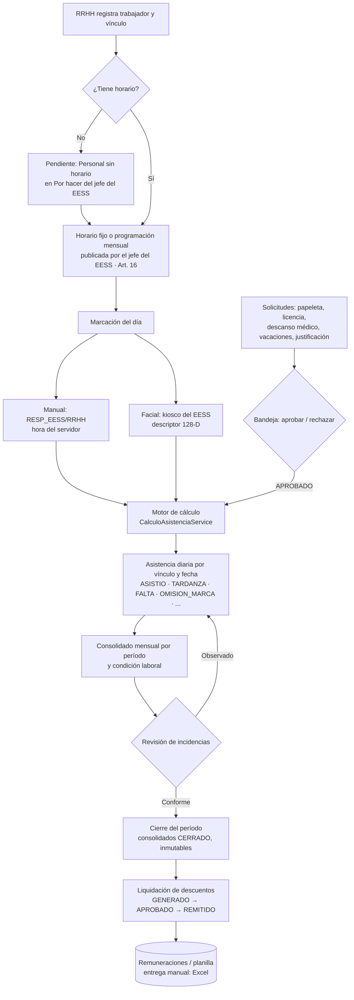
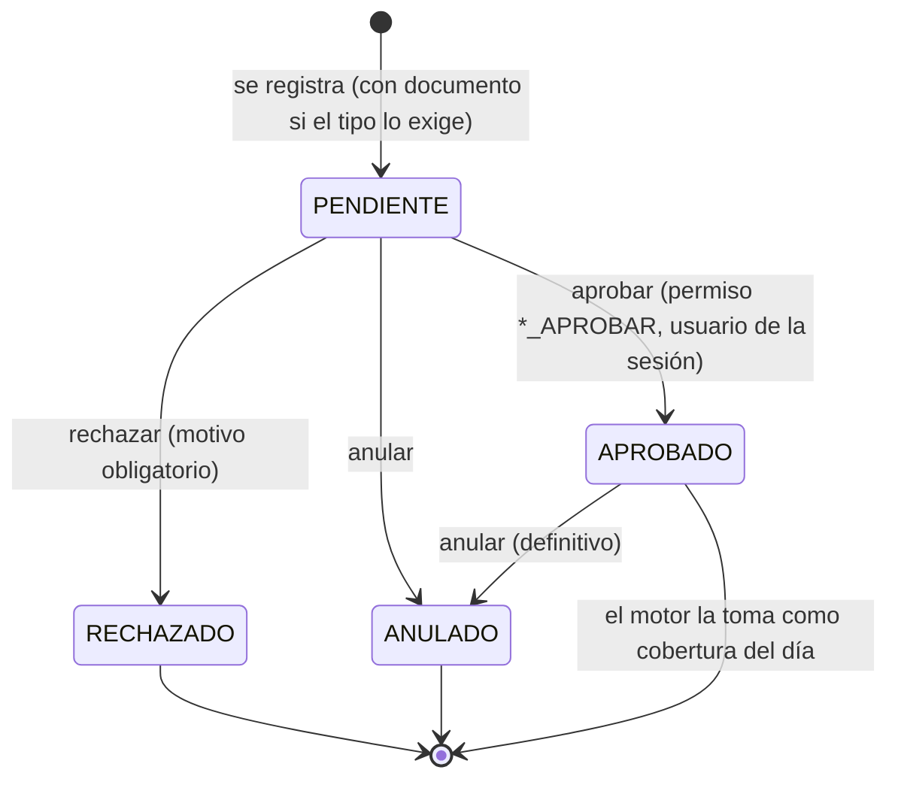
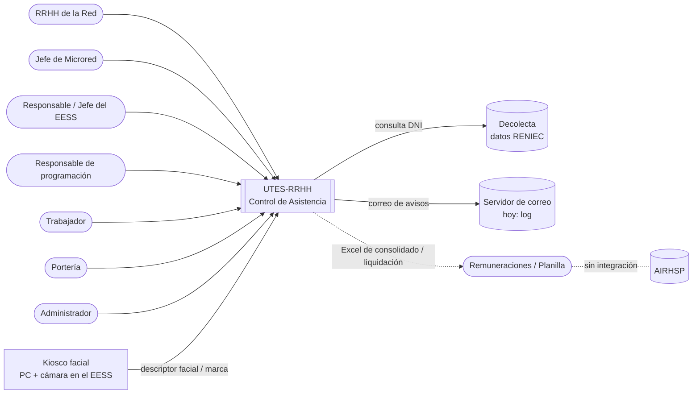
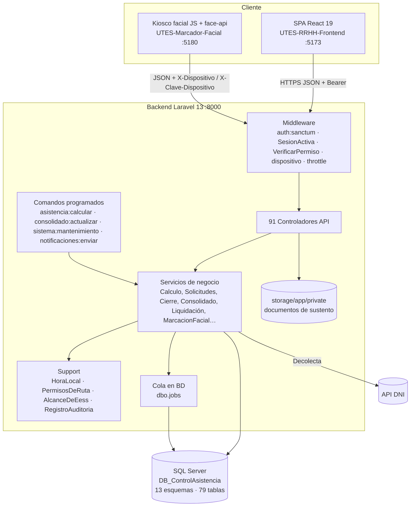
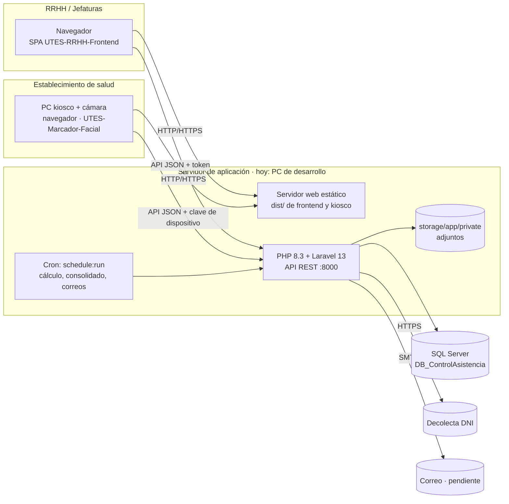

# Estado actual del sistema — UTES-RRHH (Control de Asistencia)

**Proyecto:** Sistema web para mejorar el control de asistencias al personal de establecimientos de salud en la UTES 2026 (Red de Salud Trujillo – UTES N.° 6 / UE 409 Salud Trujillo Este).
**Fecha del corte:** 2026-10-20.
**Elaborado a partir de:** el código, las bases de datos, la documentación y el historial de git de `C:\Proyectos`.

**Cómo leer este documento:**
- **Estados:** **IMPLEMENTADO** quiere decir que está en el código y tiene pruebas. **EN PROGRESO** quiere decir que existe en parte. **PENDIENTE** quiere decir que no existe.
- **NO DISPONIBLE:** marca un dato que no aparece ni en el código ni en la documentación. Todos se recogen en la sección 18.
- **Rutas:** son relativas a cada proyecto. `BE/` es `UTES-RRHH-Backend`, `FE/` es `UTES-RRHH-Frontend` y `KF/` es `UTES-Marcador-Facial`.

---

## 1. Resumen general

El sistema controla la asistencia del personal de la red, aplicando el Reglamento Interno de Trabajo (RIT) aprobado por RD 2583-2025. Cubre el ciclo completo, en este orden:

1. Organización: microredes y establecimientos (EESS).
2. Personal y su vínculo laboral.
3. Horarios y programación mensual de turnos.
4. Marcación: manual con la hora del servidor, o facial desde un kiosco.
5. Cálculo automático de la asistencia diaria con la escala del Art. 22.
6. Solicitudes con aprobación en línea y documento adjunto: papeletas, licencias, descansos médicos, justificaciones y vacaciones.
7. Consolidado mensual por condición laboral, revisión y cierre del período.
8. Liquidación de descuentos para Remuneraciones, auditoría y notificaciones.

| Dato | Valor | Evidencia |
|---|---|---|
| Avance global estimado | **≈ 70 %** (promedio de OE1–OE6; ver sección 15). Es una estimación del analista, no una medición. | Sección 15 |
| Proyectos | 3 carpetas: backend (API), frontend (SPA) y kiosco facial | `C:\Proyectos` |
| Repositorios git | `httpsfranz/UTES-RRHH-Backend`, `httpsfranz/UTES-RRHH-Frontend`. El kiosco **no tiene repositorio git**. | `git remote -v` |
| Rama principal | Backend: `main` (remota por defecto `origin/HEAD -> origin/main`). Frontend: `master`. Se trabaja en `testing`, que es la rama actual en ambos. Ramas existentes: `main`/`master`, `develop`, `testing`. | `git branch -a` |
| Último commit | Backend: `9a7920d` "API RENIEC", 2026-10-13 16:28 (-05). Frontend: `774e036` "API RENIEC", 2026-10-13 16:29 (-05). | `git log` |
| Trabajo sin commit | Todo lo hecho entre el 13 y el 20 de octubre sigue sin commit: 82 archivos modificados y 48 nuevos en el backend; 113 modificados, 28 borrados y 72 nuevos en el frontend. Incluye V005, V006, el rediseño por tareas y el kiosco facial. | `git status --short` |
| Pruebas automatizadas | 1143 pruebas PHPUnit, con 14 280 aserciones: 1132 pasan, 11 se omiten y ninguna falla. Ejecución del 2026-10-20 en 61 s. | `php artisan test` |
| Base de datos | SQL Server 2025 Express (17.0.1000.7). 13 esquemas de negocio, 79 tablas de negocio y 11 tablas de Laravel en `dbo`. | Consulta a `sys.tables` |

---

## 2. Metodología de trabajo

| Aspecto | Estado / evidencia |
|---|---|
| Metodología formal (Scrum, Kanban, etc.) | **NO DISPONIBLE.** No hay mención de Scrum, sprints ni Kanban en el repositorio ni en la documentación. |
| Forma de trabajo que muestra la evidencia | **Desarrollo incremental por niveles de dependencia de tablas**, según la *Hoja de Ruta de Dependencias* (`BE/docs/Hoja de Ruta de Dependencias – Orden de Construcción de Módulos.pdf`). El nivel 0 son los catálogos sin dependencias y el nivel N depende de un nivel menor. Los niveles 0 a 6 construyen las 78 tablas; los niveles 7 a 11 agregan acceso, automatización, rediseño y biometría (ver los nombres de prueba en `BE/tests/Feature/Nivel*`). |
| Proceso de cada módulo | Primero se lee el RIT, luego se construye el backend con pruebas contra SQL Server real y al final el frontend con pruebas de navegador (E2E). Fuente: `C:\Proyectos\CONTEXTO_TRASPASO_UTES-RRHH.txt`, sección 3. |
| Revisión externa | Revisión del docente asesor y de un *tester* humano, con observaciones de usabilidad y alcance registradas al final de `CONTEXTO_TRASPASO_UTES-RRHH.txt`. Su fecha exacta y sus participantes: **NO DISPONIBLE**. |
| Herramientas de apoyo | Se usó un agente de programación con IA (Claude Code), con guías de Laravel Boost (`BE/CLAUDE.md`, `BE/AGENTS.md`) y documentos de traspaso entre sesiones (`CONTEXTO_TRASPASO_UTES-RRHH.txt`, `AUDITORIA_PENDIENTES.md`, `Reporte_UTES-RRHH.docx`). |

### 2.1 Cronograma real según git

| Repositorio | Primer commit | Último commit | Commits (todas las ramas) | Autores (commits) |
|---|---|---|---|---|
| Backend | 2026-09-15, `53a9a5b` "tarea: inicializacion del backend" | 2026-10-13, `9a7920d` | 23 | Andersson Urbina (17), Francisco2o2o (2), daleyvac / Jordan Leyva (3, mismo correo), thonyalfaro123-lang (1) |
| Frontend | 2026-09-24, `ae0fe86` "Alojamiento del proyecto UTES RRHH Frontend" | 2026-10-13, `774e036` | 19, más 2 de *stash* | Andersson Urbina (12), Francisco2o2o (5), daleyvac (2) |

### 2.2 Etapas principales (hitos)

| # | Fechas | Hito | Evidencia |
|---|---|---|---|
| 1 | 15–19 set | Inicio del backend, conexión a SQL Server, esquema base V001 y primer CRUD (Microred) | commits `53a9a5b`, `4a8e4e2`, `d9b62d8`, `eea5235` |
| 2 | 21–30 set | Módulos de nivel 0, repartidos entre los integrantes; normalización de componentes del frontend | commits `19a2c4e`, `9a663ab`, `3f7e3c3`, `64a171d`, `f4e61d6`, `e8ce435` |
| 3 | 1–2 oct | Niveles 1 a 6: los 78 módulos con API y pantalla; V002 y V003 | `6c66adf`, `22b9c53`, `a923cc4`; `Reporte_UTES-RRHH.docx` |
| 4 | 6 oct | Motor de cálculo de asistencia (V004) y calendario mensual con PDF | memoria de sesión; `BE/tests/Feature/Nivel3CalculoAsistenciaTest.php` |
| 5 | 12–13 oct | Login, roles y alcance; automatización; importación por Excel; consulta de DNI | `4a25753`, `3dc914f`, `9a7920d`; `AUDITORIA_PENDIENTES.md` |
| 6 | 19–20 oct (sin commit) | Rediseño tras la revisión del docente y el *tester*: menú por tarea, marcación con hora del servidor, V005 y V006, bandeja única, cierre del mes, programación en grilla | `BE/tests/Feature/Nivel9*`, `Nivel10*` |
| 7 | 20 oct (sin commit) | Kiosco de marcación facial (proyecto aparte) | `KF/`, `BE/tests/Feature/Nivel11MarcadorFacialTest.php` |

**Cronograma planificado del informe** (fechas de cada fase y Gantt): **NO DISPONIBLE**.

---

## 3. Stack tecnológico

Las versiones son las instaladas según `composer.lock` y `package-lock.json`. Entre paréntesis va la restricción declarada.

### 3.1 Backend (`BE/composer.json`)

| Componente | Versión | Uso |
|---|---|---|
| PHP | 8.3.33 (`^8.3`), con extensiones `sqlsrv`, `pdo_sqlsrv` y OPcache | Lenguaje |
| laravel/framework | v13.32.0 (`^13.17`) | Framework de la API REST |
| laravel/sanctum | v4.3.3 | Tokens de sesión |
| laravel/tinker | v3.0.2 | Consola |
| dompdf/dompdf | v3.1.6 | PDF de calendarios |
| openspout/openspout | v5.3.0 | Excel: importar trabajadores, exportar consolidado y auditoría |
| composer/ca-bundle | 1.5.14 | Certificados para llamar a servicios externos (consulta de DNI) |
| Composer | 2.10.3 | Gestor de dependencias |

### 3.2 Frontend (`FE/package.json`)

| Componente | Versión |
|---|---|
| react / react-dom | 19.3.0 (`^19.2.8`) |
| react-router-dom | 7.18.4 |
| axios | 1.20.0 |
| tailwindcss / @tailwindcss/vite | 4.3.3 |
| lucide-react (íconos) | 1.48.0 |
| motion (animaciones) | 13.4.3 |
| vite | 8.3.1 |
| @vitejs/plugin-react | 6.1.1 |

### 3.3 Kiosco facial (`KF/package.json`)

| Componente | Versión |
|---|---|
| @vladmandic/face-api, que usa TensorFlow.js; modelos SSD MobileNet v1, 68 puntos faciales y reconocimiento | 1.7.15 |
| vite | 8.3.0 |
| Interfaz | HTML, CSS y JavaScript sin framework |

### 3.4 Base de datos

- **Motor:** Microsoft SQL Server 2025 Express Edition (17.0.1000.7), instancia `localhost\SQLEXPRESS`.
- **Bases:** `DB_ControlAsistencia` (trabajo) y `DB_ControlAsistencia_Test` (pruebas, la fija `BE/phpunit.xml`).
- **Conexión:** autenticación de Windows, `DB_ENCRYPT=yes` y certificado de confianza (`BE/.env.example`).

### 3.5 Herramientas de desarrollo y de pruebas

| Herramienta | Versión | Uso |
|---|---|---|
| phpunit/phpunit | 12.5.35 | Pruebas del backend |
| laravel/pint | v1.32.1 | Formato de código PHP |
| laravel/boost | v2.10.1 | Guías para el asistente de IA (`CLAUDE.md`, `AGENTS.md`) |
| laravel/pail | v1.2.7 | Visor de logs |
| mockery | 1.6.15 | Dobles de prueba |
| fakerphp/faker | v1.24.1 | Datos falsos |
| nunomaduro/collision | v8.9.5 | Errores en consola |
| eslint | 10.11.0, con eslint-plugin-react-hooks 7.1.1 | Calidad del código del frontend |
| Node.js / npm | v24.21.0 / 11.19.0 | Entorno JS |
| puppeteer-core + Microsoft Edge en modo *headless* | — | Pruebas E2E de navegador (scripts `.mjs` fuera del repositorio) |

- **Docker:** no se usa. No hay `Dockerfile` ni `docker-compose`.
- **Integración continua:** **PENDIENTE**. No hay `.github/workflows` ni otra configuración de CI.

---

## 4. Estructura del repositorio

```
C:\Proyectos
├── UTES-RRHH-Backend/                API REST (Laravel)
│   ├── app/
│   │   ├── Console/Commands/          7 comandos artisan (cálculo, consolidado, mantenimiento, correos, claves de kiosco…)
│   │   ├── Http/Controllers/Api/      91 controladores
│   │   ├── Http/Middleware/           SesionActiva, VerificarPermiso, DispositivoDeMarcacion
│   │   ├── Http/Requests/             86 Form Requests (validación y reglas del RIT)
│   │   ├── Http/Resources/            79 Resources (salida JSON en snake_case)
│   │   ├── Models/<Esquema>/          80 modelos Eloquent, agrupados por esquema SQL
│   │   ├── Services/                  ~38 servicios de negocio (motor de asistencia, solicitudes, cierre…)
│   │   └── Support/                   HoraLocal, PermisosDeRuta, AlcanceDeEess, RegistroAuditoria, RunsSqlFile…
│   ├── config/                        configuración (incluye biometria.php, sanctum.php, cors.php)
│   ├── database/
│   │   ├── sql/                       V001–V006 y R001–R006: scripts T-SQL versionados (fuente de verdad del esquema)
│   │   ├── migrations/                migraciones-cáscara que ejecutan cada V0XX
│   │   ├── seeders/                   catálogos, usuarios y permisos, datos de prueba con volumen
│   │   └── diagnostico/               validacion_esquema.sql (para SSMS)
│   ├── docs/                          RIT 2025 (PDF), Hoja de Ruta, Manual de desarrollo, guía SQL Server, este documento
│   ├── routes/                        api.php (454 rutas) y console.php (tareas programadas)
│   └── tests/Feature, tests/Unit      39 archivos de prueba (Nivel0 a Nivel11)
├── UTES-RRHH-Frontend/                SPA (React)
│   └── src/
│       ├── api/                       cliente axios y caché de opciones
│       ├── auth/, components/auth/    sesión, RequiereSesion, RequierePermiso
│       ├── components/ui/             80 componentes propios; el único lugar con clases Tailwind
│       ├── components/                Sidebar, Navbar, buscador del menú, campana de notificaciones
│       ├── dashboard/                 panel de inicio por rol
│       ├── hooks/                     15 hooks (useCrudResource, useConsulta, useBandeja…)
│       ├── nav/                       menu.js, acceso.js, permisosDeApi.js (espejo de permisos)
│       ├── pages/<modulo>/            156 archivos de pantallas y formularios, en 13 módulos
│       └── routes.jsx                 rutas (carga diferida) y redirecciones de rutas antiguas
├── UTES-Marcador-Facial/              kiosco de marcación facial
│   ├── src/                           main.js, rostro.js (face-api), api.js, config.js, estilos.css
│   └── scripts/copiar-modelos.mjs     copia los modelos de face-api a public/models
├── AUDITORIA_PENDIENTES.md            auditoría de pendientes (12 y 13 oct)
├── CONTEXTO_TRASPASO_UTES-RRHH.txt    traspaso técnico y observaciones del tester (19 oct)
├── PLAN_MEJORAS_CALENDARIO.md         plan de calendarios
├── Control de Asistencia.pdf          referencia visual del sistema anterior (programación de turnos)
└── Reporte_UTES-RRHH.docx             reporte de avance de los niveles 0 a 6
```

---

## 5. Requerimientos

No hay un documento formal de requerimientos (ERS) aprobado por el área usuaria: **NO DISPONIBLE**. Los requerimientos de esta sección se reconstruyeron a partir del RIT y del código.

### 5.1 Requerimientos funcionales

| ID | Requerimiento | Módulo | Estado | Evidencia |
|---|---|---|---|---|
| RF01 | Registrar microredes, establecimientos y sus responsables | Organización | IMPLEMENTADO | `BE/app/Http/Controllers/Api/MicroredController.php`, `EstablecimientoSaludController.php`, `ResponsableEessController.php`; `FE/src/pages/organizacion/OrganizacionPage.jsx` |
| RF02 | Dar de alta a un trabajador con consulta de DNI (Decolecta) | Personal | IMPLEMENTADO | `BE/app/Services/ConsultaDni/`; `FE/src/pages/personal/NuevoTrabajadorAsistente.jsx` |
| RF03 | Registrar el vínculo laboral (EESS, cargo, régimen, condición, código AIRHSP); un solo vínculo vigente salvo el 2.º vínculo médico (Art. 86) | Personal | IMPLEMENTADO | `BE/app/Http/Requests/VinculoLaboralRequest.php`; V003 |
| RF04 | Asignar un horario fijo o rotativo, que es opcional en el alta y queda como pendiente "Personal sin horario" | Personal | IMPLEMENTADO | `BE/app/Services/PersonalSinHorarioService.php`; `Nivel10PersonalSinHorarioTest.php` |
| RF05 | Importar trabajadores en masa desde Excel o CSV | Personal | IMPLEMENTADO (solo crea personas, no vínculos) | `BE/app/Services/ImportacionTrabajadoresService.php` |
| RF06 | Configurar turnos, horarios, jornadas y la escala de tolerancia del Art. 22 | Configuración | IMPLEMENTADO | `BE/database/sql/V002__tramo_tolerancia_segun_rit.sql`; `FE/src/pages/configuracion/` |
| RF07 | Elaborar la programación mensual en una grilla trabajador × día, copiar la del mes anterior, y publicarla o cerrarla | Programación | IMPLEMENTADO | `BE/app/Services/ProgramacionMensualService.php`; `FE/src/pages/programacion/ProgramacionMensualPage.jsx` |
| RF08 | Cambios de turno (reprogramación, permuta, reemplazo, anulación) con aprobación | Programación | IMPLEMENTADO | `BE/app/Services/CambioTurnoService.php` |
| RF09 | Marcación manual de entrada y salida con la hora del servidor, sin digitar la hora | Asistencia | IMPLEMENTADO | `BE/app/Services/MarcacionManualService.php`; `POST /api/asistencia-diaria/marcar` |
| RF10 | Marcación por reconocimiento facial desde un kiosco con cámara | Asistencia / Biometría | IMPLEMENTADO (prototipo funcional, sin prueba de vida) | `KF/`; `BE/app/Services/MarcacionFacialService.php` |
| RF11 | Importar marcaciones desde el archivo de un reloj biométrico comercial | Asistencia | **PENDIENTE**: `CargaAsistenciaManual` guarda la cabecera de la carga pero no importa filas | `BE/app/Services/CargaAsistenciaManualService.php` (solo `anular`) |
| RF12 | Calcular automáticamente la asistencia diaria: tardanza según escala, falta, omisión de marca, salida anticipada, guardia | Asistencia | IMPLEMENTADO | `BE/app/Services/CalculoAsistenciaService.php`; `Nivel3CalculoAsistenciaTest.php` (24 pruebas) |
| RF13 | Calendario de asistencia por EESS en vista día, semana y mes, con exportación a PDF | Asistencia | IMPLEMENTADO | `BE/app/Services/CalendarioAsistenciaService.php`, `CalendarioAsistenciaPdf.php`; `FE/src/pages/asistencia/AsistenciaDiariaPage.jsx` |
| RF14 | Ajuste de una marcación con sustento y aprobación | Asistencia | IMPLEMENTADO | `BE/app/Services/AjusteMarcacionService.php` |
| RF15 | Papeletas de salida (comisión, permisos, lactancia, etc.) con aprobación | Solicitudes | IMPLEMENTADO | `BE/app/Services/SolicitudService.php`; `PapeletaController` |
| RF16 | Licencias, con días corridos y máximo por tipo | Solicitudes | IMPLEMENTADO (catálogo incompleto frente al RIT, ver 17) | `LicenciaRequest`; `Solicitudes.TipoLicencia` (9 tipos) |
| RF17 | Descansos médicos y constatación domiciliaria | Solicitudes | IMPLEMENTADO | `DescansoMedicoController`, `ConstatacionDomiciliariaController` |
| RF18 | Justificación de faltas, que pasa la falta a FALTA_JUST | Solicitudes / Asistencia | IMPLEMENTADO (no se aplica el plazo de 3 días) | `BE/app/Services/JustificacionFaltaService.php` |
| RF19 | Adjuntar el documento de sustento: subida y descarga reales, con límite `MAX_ADJUNTO_MB` | Soporte | IMPLEMENTADO | `BE/app/Http/Controllers/Api/DocumentoSustentoController.php`; `Nivel8DocumentosTest.php` |
| RF20 | Bandeja única de solicitudes pendientes, con aprobación o rechazo según permiso y alcance | Solicitudes | IMPLEMENTADO | `BE/app/Services/BandejaDeSolicitudesService.php`; `FE/src/pages/solicitudes/BandejaDeSolicitudesPage.jsx` |
| RF21 | Vacaciones: récord, rol vacacional y goce | Vacaciones | IMPLEMENTADO | `RolVacacionalService.php`, `GoceVacacionalService.php` |
| RF22 | Compensación horaria con autorización previa y horas detectadas desde la marca de salida (Art. 17) | Compensaciones | IMPLEMENTADO | `BE/app/Services/CompensacionHorariaService.php`; `Nivel9CompensacionAutomaticaTest.php` |
| RF23 | Consolidado mensual por trabajador y período, con detalle diario | Consolidación | IMPLEMENTADO | `BE/app/Services/ConsolidadoAsistenciaService.php` |
| RF24 | Revisión del consolidado (incidencias, observar, aprobar) y exportación a Excel con una hoja por condición laboral | Consolidación | IMPLEMENTADO | `BE/app/Services/RevisionConsolidadoService.php` |
| RF25 | Cierre del mes guiado en 5 pasos y cierre del período (congela los consolidados) | Consolidación | IMPLEMENTADO | `BE/app/Services/CierreDelMesService.php`; `PeriodoAsistenciaController::update` |
| RF26 | Liquidación de descuentos (generar, aprobar, remitir a planilla) | Compensaciones | EN PROGRESO: cantidades automáticas, importes manuales | `BE/app/Services/LiquidacionDescuentoService.php` |
| RF27 | Disciplina: expedientes PAD (numeración automática) y supervisiones inopinadas, que pueden iniciar un PAD | Disciplina | IMPLEMENTADO | `ExpedientePadService.php`; `POST supervisiones-inopinadas/{id}/iniciar-pad` |
| RF28 | Login, cierre de sesión y cambio de contraseña propio | Seguridad | IMPLEMENTADO | `BE/app/Http/Controllers/Api/AuthController.php` |
| RF29 | Usuarios, roles, permisos y alcance por microred o EESS; bloqueo de cuentas; revocación de sesiones | Seguridad | IMPLEMENTADO | `SeguridadDeCuentaService.php`, `RolPermisoService.php`, `AlcanceDeEess.php` |
| RF30 | Auditoría de cambios y de eventos de seguridad, consultable y exportable | Seguridad | IMPLEMENTADO (no registra lecturas) | `BE/app/Support/RegistroAuditoria.php`; trigger `TR_Auditoria_Inmutable` |
| RF31 | Notificaciones internas (campana) y por correo, con reintentos | Soporte | IMPLEMENTADO (el correo va a un log mientras no haya SMTP) | `BE/app/Services/NotificacionService.php` |
| RF32 | Calendario no laborable (feriados) por microred o para toda la red | Soporte | IMPLEMENTADO | `BE/app/Services/CalendarioNoLaborableService.php` |
| RF33 | Biometría: consentimiento, plantillas faciales, dispositivos y autorización de marcación manual | Biometría | IMPLEMENTADO | `FE/src/pages/biometria/BiometriaPage.jsx`; `ConsentimientoBiometricoService.php` |
| RF34 | Panel de inicio por rol, con indicadores y una lista de tareas "Por hacer" | Inicio | IMPLEMENTADO | `BE/app/Services/Dashboard/DashboardService.php` |
| RF35 | Procesos automáticos (recálculo cada hora, consolidado diario, vencimiento de compensaciones, aviso de faltas reiteradas) | Automatización | IMPLEMENTADO | `BE/routes/console.php`; `Nivel7AutomatizacionTest.php` |
| RF36 | Reportes formales: anexos 12 a 17, tardanzas por trabajador, planilla de descuentos | Reportes | **PENDIENTE**: solo existen los PDF de calendarios y los Excel de consolidado y auditoría | `AUDITORIA_PENDIENTES.md` (AUD-011) |
| RF37 | Aprobación en dos pasos (visto bueno del jefe del EESS y luego RRHH) | Solicitudes | **PENDIENTE**: hoy la aprobación es de un solo paso | `SolicitudService.php` |
| RF38 | Asignación temporal de personal a otro EESS (refuerzos) | Programación | **PENDIENTE** (propuesta, sin aprobar el cambio de esquema) | `AUDITORIA_PENDIENTES.md`, sección 3.A |

### 5.2 Requerimientos no funcionales

| Tipo | Requerimiento | Estado | Evidencia |
|---|---|---|---|
| Seguridad | Toda la API exige token, salvo el login y las rutas del kiosco | IMPLEMENTADO | 451 de 454 rutas con `auth:sanctum` + `SesionActiva`; 448 además con `VerificarPermiso` |
| Seguridad | La sesión expira tras 30 min sin actividad; el token vence a las 12 h | IMPLEMENTADO | `SESION_INACTIVIDAD_MIN=30`; `config/sanctum.php` `expiration` 720 |
| Seguridad | La cuenta se bloquea 15 min tras 5 intentos fallidos; login limitado a 10 intentos por minuto | IMPLEMENTADO | `LOGIN_INTENTOS_MAX`, `LOGIN_BLOQUEO_MIN`; `routes/api.php:116` |
| Seguridad | La auditoría no se puede modificar | IMPLEMENTADO | trigger `Seguridad.TR_Auditoria_Inmutable` (V005) |
| Integridad | Las marcas usan la hora del servidor (Lima), nunca la del equipo del usuario | IMPLEMENTADO | `BE/app/Support/HoraLocal.php` |
| Integridad | Un período cerrado es inmutable y el motor no lo recalcula | IMPLEMENTADO | `CalculoAsistenciaService::periodoCerrado` |
| Integridad | Los scripts SQL aplicados no se pueden editar (verificación SHA-256) | IMPLEMENTADO | `BE/app/Support/RunsSqlFile.php`; `dbo.SqlScriptAplicado` |
| Rendimiento | Carga diferida de páginas; caché de opciones de 60 s; CORS con `max_age` de 7200 s | IMPLEMENTADO | `FE/src/routes.jsx`, `FE/src/api/cacheDeOpciones.js` |
| Rendimiento | Paginación y filtros en el servidor para tablas de más de 10 000 filas | EN PROGRESO (algunos listados aún paginan en el cliente) | `AUDITORIA_PENDIENTES.md` |
| Rendimiento | Tiempos de respuesta medidos | **NO DISPONIBLE** (solo hay una nota de 0,2–0,3 s por petición con `artisan serve`) | `AUDITORIA_PENDIENTES.md`, sección 4 |
| Usabilidad | Menú por tarea: 14 entradas en 5 grupos (antes 76); pestañas y modales de configuración | IMPLEMENTADO | `FE/src/nav/menu.js` |
| Usabilidad | Interfaz en español, diseño adaptable (escritorio y móvil) | IMPLEMENTADO | `FE/src/components/ui/`; E2E `movil.mjs` |
| Mantenibilidad | Contrato de API fijo: sale en snake_case y entra con los nombres de columna | IMPLEMENTADO | `BE/app/Http/Resources`, `Requests` |
| Mantenibilidad | Estilos solo en componentes; las páginas no llevan `className` | EN PROGRESO: 5 archivos de `pages` aún usan `className` (`ImportarTrabajadoresModal`, `NuevoTrabajadorAsistente`, `FichaTrabajadorModal`, `CierreDelMesPage`, `OrganizacionPage`) | `grep -rn className FE/src/pages` |
| Disponibilidad | Servidor de producción, alta disponibilidad, monitoreo | **PENDIENTE / NO DISPONIBLE** | Sección 11 |
| Privacidad | Los datos biométricos solo se guardan con consentimiento; el kiosco no envía fotos, solo el descriptor | IMPLEMENTADO | `MarcacionFacialService.php`, `KF/src/rostro.js` |

### 5.3 Roles, permisos y ámbito

Fuentes: `BE/database/seeders/UsuariosYPermisosSeeder.php` (constante `MATRIZ`) y `Seguridad.RolPermiso`. Hay 25 permisos y 7 roles. ✔ = el rol tiene el permiso.

| Permiso | ADMIN | RRHH_RED | JEFE_MICRORED | RESP_EESS | PROGRAMADOR | TRABAJADOR | PORTERIA |
|---|---|---|---|---|---|---|---|
| `ASISTENCIA_VER` | ✔ | ✔ | ✔ | ✔ | ✔ | ✔ | · |
| `ASISTENCIA_EDITAR` | ✔ | ✔ | · | ✔ | · | · | · |
| `ASISTENCIA_MARCAR` | ✔ | ✔ | · | ✔ | · | · | · |
| `ASISTENCIA_JUSTIFICAR` | ✔ | ✔ | · | ✔ | · | · | · |
| `ASISTENCIA_APROBAR` | ✔ | ✔ | ✔ | ✔ | · | · | · |
| `PERSONAL_VER` | ✔ | ✔ | ✔ | ✔ | ✔ | · | · |
| `PERSONAL_EDITAR` | ✔ | ✔ | · | · | · | · | · |
| `ORGANIZACION_VER` | ✔ | ✔ | ✔ | ✔ | · | · | · |
| `ORGANIZACION_EDITAR` | ✔ | ✔ | · | · | · | · | · |
| `PROGRAMACION_VER` | ✔ | ✔ | ✔ | ✔ | ✔ | · | · |
| `PROGRAMACION_EDITAR` | ✔ | ✔ | · | ✔ | ✔ | · | · |
| `PROGRAMACION_APROBAR` | ✔ | ✔ | · | ✔ | · | · | · |
| `SOLICITUDES_VER` | ✔ | ✔ | ✔ | ✔ | · | ✔ | ✔ |
| `SOLICITUDES_EDITAR` | ✔ | ✔ | · | ✔ | · | · | ✔ |
| `SOLICITUDES_APROBAR` | ✔ | ✔ | ✔ | ✔ | · | · | · |
| `REPORTES_VER` | ✔ | ✔ | ✔ | ✔ | · | · | · |
| `REPORTES_EDITAR` | ✔ | ✔ | · | · | · | · | · |
| `REPORTES_EXPORTAR` | ✔ | ✔ | ✔ | ✔ | · | · | · |
| `CONFIGURACION_VER` | ✔ | ✔ | · | · | · | · | · |
| `CONFIGURACION_EDITAR` | ✔ | ✔ | · | · | · | · | · |
| `SISTEMA_PARAMETROS` | ✔ | · | · | · | · | · | · |
| `SEGURIDAD_VER` | ✔ | · | · | · | · | · | · |
| `SEGURIDAD_EDITAR` | ✔ | · | · | · | · | · | · |
| `SEGURIDAD_AUDITORIA` | ✔ | · | · | · | · | · | · |
| `LEGADO_IMPORTAR` | · | · | · | · | · | · | · |

**Ámbito de acceso** (`Seguridad.UsuarioAmbito`; lógica en `BE/app/Support/AlcanceDeEess.php` y `AccesoUsuario.php`):

| Ámbito | Qué ve | Usuarios sembrados |
|---|---|---|
| Global (MicroredId y EessId nulos) | Toda la red | `admin`, `rrhh` |
| Microred | Todos los EESS de su microred | `jefe.microred` (Microred La Esperanza) |
| EESS | Solo su establecimiento | `resp.eess`, `programador`, `porteria` (C.S. La Esperanza) |
| Propio | Solo sus vínculos, y un menú reducido a 4 pantallas | `trabajador` |

**Límite conocido (AUD-022):** el alcance filtra listados y calendarios, pero abrir, editar o borrar un registro por su id no comprueba en todos los recursos que el registro sea del EESS del usuario.

---

## 6. Arquitectura de negocio

**Procesos cubiertos:**
- Marcación: manual o facial.
- Cálculo diario.
- Solicitudes y justificaciones.
- Programación.
- Consolidado y cierre del mes.
- Liquidación y entrega a Remuneraciones, que es **manual**: el sistema marca la liquidación como REMITIDO y exporta el Excel, pero no existe integración con la planilla ni con AIRHSP.



**Ciclo de las solicitudes** (papeletas, licencias, descansos médicos, justificaciones, ajustes de marcación, goces vacacionales, cambios de turno). Las restricciones `CK_*Estado` en `BE/database/sql/V001__esquema_base.sql` (líneas 1081–1617) admiten estos estados, y la lógica está en `BE/app/Services/SolicitudService.php`:



Las reglas del ciclo son:
- Solo se aprueba o rechaza desde PENDIENTE.
- Anular es definitivo y no falla si se repite.
- Al resolver se notifica a quien registró la solicitud, en la misma transacción.

---

## 7. Arquitectura de aplicaciones

### 7.1 Diagrama de contexto



### 7.2 Diagrama de componentes



### 7.3 Backend

| Elemento | Cantidad / detalle | Ubicación |
|---|---|---|
| Controladores | 91, la mayoría CRUD con `index`, `store`, `show`, `update` y `destroy` (desactivar) más acciones de flujo | `BE/app/Http/Controllers/Api/` |
| Form Requests | 86, con validación por columna y reglas del RIT en `ReglasDeNegocio` y `ReglasDeVacaciones` | `BE/app/Http/Requests/` |
| Resources | 79 | `BE/app/Http/Resources/` |
| Modelos | 80, en 13 carpetas por esquema | `BE/app/Models/` |
| Servicios | `CalculoAsistenciaService`, `CalendarioAsistenciaService`/`Pdf`, `CalendarioProgramacionService`, `ProgramacionMensualService`, `ProgramacionPeriodoService`, `ProgramacionTrabajadorService`, `TurnoProgramadoService`, `CambioTurnoService`, `MarcacionManualService`, `MarcacionFacialService`, `AjusteMarcacionService`, `CargaAsistenciaManualService`, `JustificacionFaltaService`, `SolicitudService`, `BandejaDeSolicitudesService`, `RolVacacionalService`, `GoceVacacionalService`, `CompensacionHorariaService`, `ConsolidadoAsistenciaService`, `DetalleConsolidadoService`, `RevisionConsolidadoService`, `CierreDelMesService`, `LiquidacionDescuentoService`, `ExpedientePadService`, `TrabajadorService`, `ImportacionTrabajadoresService`, `PersonalSinHorarioService`, `ConsultaDni/*`, `PlantillaBiometricaService`, `ConsentimientoBiometricoService`, `HorarioDetalleService`, `CalendarioNoLaborableService`, `NotificacionService`, `AutomatizacionService`, `SeguridadDeCuentaService`, `RolPermisoService`, `Dashboard/DashboardService` | `BE/app/Services/` |
| Middleware | `SesionActiva` (inactividad, vencimiento, revocación), `VerificarPermiso` (aplica `PermisosDeRuta`), `DispositivoDeMarcacion` (clave HMAC del kiosco) | `BE/app/Http/Middleware/` |
| Colas | `QUEUE_CONNECTION=database`; el correo se envía con `dispatch(...)->afterResponse()` y también con el comando `notificaciones:enviar` | `BE/app/Services/NotificacionService.php:51` |
| Jobs | No hay clases Job: se usan closures y comandos | — |
| Comandos | `asistencia:calcular`, `consolidado:actualizar`, `sistema:mantenimiento`, `notificaciones:enviar`, `biometria:clave-dispositivo`, `pruebas:preparar`, `sql:estado` (`EstadoEsquema`) | `BE/app/Console/Commands/` |
| Tareas programadas | Cada hora: `asistencia:calcular --dias=2`. 02:00: `--dias=10`. 02:30: `consolidado:actualizar`. 03:00: `sistema:mantenimiento`. Cada minuto: `notificaciones:enviar`. | `BE/routes/console.php` |

### 7.4 Endpoints de la API

Totales:
- **454 rutas** con **528 combinaciones** de método y ruta, sobre **89 recursos**.
- 3 rutas no usan sesión: `POST /api/auth/login` y las 2 del kiosco.
- Todas están IMPLEMENTADAS y pasan las pruebas Feature.

**Regla de permisos** (`BE/app/Support/PermisosDeRuta.php`):
- `GET` de un recurso exige `{MODULO}_VER`.
- `POST`, `PUT` y `DELETE` exigen `{MODULO}_EDITAR`.
- Las acciones de flujo exigen su propio permiso.
- Los catálogos de apoyo solo exigen sesión.

La tabla completa, generada desde `route:list` y `PermisosDeRuta`, está en el **Anexo A**. Resumen por módulo:

| Módulo (permiso) | Recursos principales (`/api/...`) | Operaciones |
|---|---|---|
| Autenticación | `auth/login`, `auth/logout`, `auth/me`, `auth/cambiar-password`, `user` | Sesión |
| Inicio | `dashboard`, `menu-pendientes`, `bandeja-solicitudes`, `notificaciones` | Lectura y marcar como leídas |
| ORGANIZACION | `microredes`, `establecimientos`, `responsables-eess`, `tipos-establecimiento`, `tipos-responsabilidad` | CRUD |
| PERSONAL | `trabajadores` (+ `plantilla`, `importar`), `vinculos-laborales`, `asignaciones-horario`, `cargos`, `profesiones`, `colegiaturas`, `consulta-dni/{dni}`… | CRUD, importación, DNI |
| ASISTENCIA | `marcaciones`, `asistencia-diaria` (+ `calendario`, `calendario/pdf`, `calcular`, `marcar`), `ajustes-marcacion`, `justificaciones-falta`, `estados-asistencia`, `conceptos-justificacion` | CRUD, cálculo, marcación, aprobación |
| PROGRAMACION | `programacion-mensual` (+ `celda`, `copiar`), `programaciones-periodo` (+ `publicar`, `cerrar`), `turnos-programados` (+ `cumplir`), `cambios-turno`, `informes-guardia-comunitaria`, `programacion-calendario/*` | Grilla, flujo, PDF |
| SOLICITUDES | `papeletas`, `licencias`, `descansos-medicos`, `constataciones-domiciliarias`, `ocurrencias-porteria`, `periodos-vacacionales`, `roles-vacacionales`, `goces-vacacionales`, `documentos-sustento` (+ `archivo`) | CRUD, aprobar/rechazar, adjuntos |
| CONFIGURACION | `turnos`, `horarios` (+ `detalle`), `tipos-jornada`, `parametros-jornada`, `tablas-tolerancia`, `tramos-tolerancia`, `calendario-no-laborable`, `dispositivos-marcacion`, `metodos-marcacion`, `plantillas-biometricas`, `consentimientos-biometricos`, `autorizaciones-metodo` (+ `resumen`) | CRUD |
| REPORTES | `periodos-asistencia`, `cierre-mes` (+ `conformidad`, `liquidaciones`), `consolidados-asistencia` (+ `generar`, `incidencias`, `observar`, `aprobar`, `exportar`), `liquidaciones-descuento` (+ `aprobar`, `remitir`), `compensaciones-horarias` (+ `candidatas`, `aprobar`, `devolver`), `expedientes-pad`, `supervisiones-inopinadas` (+ `iniciar-pad`) | Flujo de fin de mes |
| SEGURIDAD | `usuarios` (+ `bloquear`, `desbloquear`), `roles` (+ `permisos`), `usuarios-roles`, `usuarios-ambitos`, `permisos`, `sesiones-acceso` (+ `revocar`), `auditoria` (+ `exportar`), `logs-integracion`, `parametros-sistema`, `tipos-notificacion` | Administración |
| Kiosco (clave de dispositivo) | `GET marcador-facial/estado`, `POST marcador-facial/marcar` | Marcación facial |

### 7.5 Frontend: pantallas

Las rutas están en `FE/src/routes.jsx` y el menú en `FE/src/nav/menu.js`. Los permisos de cada pantalla están en `FE/src/nav/acceso.js`. Las rutas antiguas redirigen a las nuevas (`RUTAS_ANTERIORES`).

| Ruta | Pantalla | Qué hace | Estado |
|---|---|---|---|
| `/login` | Inicio de sesión | Usuario y contraseña; bloqueo por intentos | IMPLEMENTADO |
| `/` | Panel de inicio | KPIs por rol, tendencia, lista de tareas "Por hacer" | IMPLEMENTADO |
| `/asistencia/asistencia-diaria` | Control de asistencia | Calendario día, semana o mes por EESS; tarjetas "Hoy" para marcar entrada y salida; detalle de la celda (justificar, solicitar ajuste); historial de marcaciones; PDF | IMPLEMENTADO |
| `/solicitudes/bandeja` | Bandeja de solicitudes ("Mis solicitudes" para el trabajador) | Pendientes de 9 tipos; aprobar o rechazar | IMPLEMENTADO |
| `/solicitudes/registro` | Registrar solicitudes | Pestañas: Papeletas, Justificación de faltas, Ajustes de marcación, Licencias, Descansos médicos, Constatación domiciliaria | IMPLEMENTADO |
| `/solicitudes/ocurrencias-porteria` | Ocurrencias de portería | Registro de ocurrencias | IMPLEMENTADO |
| `/programacion/mensual` | Programación del mes | Grilla trabajador × día con paleta de turnos; copiar mes; publicar | IMPLEMENTADO |
| `/programacion/gestion` | Cambios y ausencias | Pestañas: Cambios de turno, Ausencias y vacaciones, Guardias comunitarias, Programaciones registradas | IMPLEMENTADO |
| `/personal/trabajadores` | Trabajadores | Lista con filtros "Falta horario" y "Falta vínculo"; asistente de alta en 3 pasos; ficha con pestañas Datos, Vínculo, Horario y Cuenta; importación Excel | IMPLEMENTADO |
| `/vacaciones/gestion` | Vacaciones | Pestañas: 1. Récord, 2. Rol vacacional, 3. Goce | IMPLEMENTADO |
| `/consolidacion/cierre` | Cierre del mes | 5 pasos guiados (pendientes, conformidad, liquidaciones, cierre) | IMPLEMENTADO |
| `/consolidacion/gestion` | Consolidado y descuentos | Pestañas: Consolidado, Liquidaciones de descuento, Compensación horaria, Horas detectadas, Períodos de asistencia | IMPLEMENTADO |
| `/disciplina/gestion` | Disciplina | Pestañas: Expedientes PAD, Supervisiones inopinadas | IMPLEMENTADO |
| `/organizacion/red` | Organización | Microred (plegable), sus EESS y la ficha de cada uno con responsables | IMPLEMENTADO |
| `/configuracion/panel` | Configuración | Tarjetas por área que abren modales con 31 catálogos o paneles: jornada y tolerancias, turnos, horarios, parámetros, cargos, profesiones, condición y régimen, estados de asistencia, tipos de papeleta y licencia, biometría, dispositivos, calendario no laborable, documentos, logs de integración… | IMPLEMENTADO |
| `/seguridad/panel` | Seguridad | Usuarios, roles de cada usuario, alcance de datos, roles, permisos, sesiones de acceso, auditoría | IMPLEMENTADO |
| `/soporte/notificaciones` | Notificaciones | Historial de la bandeja (se abre desde la campana) | IMPLEMENTADO |
| Kiosco `http://localhost:5180` | Marcador facial | Pantallas: Configurar, Marcar y Registrar rostro (RRHH) | IMPLEMENTADO (prototipo) |

---

## 8. Arquitectura de datos

### 8.1 Scripts y migraciones aplicados

El esquema se construye con scripts T-SQL versionados en `BE/database/sql`, cada uno envuelto por una migración-cáscara en `BE/database/migrations`. El hash de cada script queda en `dbo.SqlScriptAplicado`; las fechas de aplicación de la tabla siguientes son las de esa tabla, tomadas de la base de trabajo.

| Script | Migración (fecha del nombre) | Aplicado | Resumen |
|---|---|---|---|
| `V001__esquema_base.sql` | 2026-09-16 | 2026-10-01 | Esquema v3.0: 13 esquemas, 78 tablas, restricciones, índices y 6 vistas, sin datos. Archivo inmutable. |
| `V002__tramo_tolerancia_segun_rit.sql` | 2026-10-01 | 2026-10-01 | `TramoTolerancia` + `MinutosDescuento` + `EsInasistencia`: escala fija del Art. 22 |
| `V003__vinculo_vigente_segundo_vinculo_medico.sql` | 2026-10-02 | 2026-10-02 | Elimina `UX_VinculoLaboral_Vigente` para permitir el 2.º vínculo médico (Art. 86) |
| `V004__asistencia_diaria_origen.sql` | 2026-10-06 | 2026-10-06 | `AsistenciaDiariaOrigen` (MANUAL o CALCULADO), para que el motor no pise lo corregido a mano |
| `V005__seguridad_notificaciones_y_flujos.sql` | 2026-10-19 | 2026-10-19 | Usuario: bloqueo, intentos, cambio de clave, último acceso. Sesión: expiración y revocación. UsuarioRol: quién asignó o revocó. Auditoría: resultado. Notificación: lectura, entrega y reintentos. Nueva tabla `Soporte.TipoNotificacion`. Quién cerró el período. Revisión del consolidado. `CompensacionHorariaFechaTrabajo`. Expediente PAD desde una supervisión. Trigger `TR_Auditoria_Inmutable`. |
| `V006__calendario_no_laborable_estado.sql` | 2026-10-19 | 2026-10-19 | `CalendarioNoLaborableEstado`: activar o desactivar un feriado sin borrarlo |

Cada `V` tiene su reverso `R001` a `R006`. Las tablas de Laravel (`users`, `cache`, `jobs`, `personal_access_tokens`, etc.) vienen de las migraciones estándar `0001_01_01_*` y `2026_09_18_*`.

**Diferencias respecto de V001:**
- Se agregaron 1 tabla (`Soporte.TipoNotificacion`, que deja el total en 79) y 1 trigger.
- Se agregaron columnas en `TramoTolerancia`, `AsistenciaDiaria`, `Usuario`, `SesionAcceso`, `UsuarioRol`, `Auditoria`, `Notificacion`, `PeriodoAsistencia`, `ConsolidadoAsistencia`, `CompensacionHoraria`, `ExpedientePad` y `CalendarioNoLaborable`.
- Se eliminó 1 índice único (`UX_VinculoLaboral_Vigente`).
- No se borró ni se renombró ninguna tabla.

**Nota:** `V001` es la versión 3.0 de 78 tablas. Existió una propuesta de 19 tablas (v4.0) que no se aplicó.

### 8.2 Esquemas y tablas actuales

La consulta a `sys.tables` de `DB_ControlAsistencia` (2026-10-20) devuelve 79 tablas de negocio en 13 esquemas. En todas las tablas la clave primaria es `<Tabla>Id`, INT IDENTITY; la única excepción es `EstablecimientoSalud`, cuya clave es `EessId`. La columna Filas es el conteo en la base de trabajo, que incluye datos de prueba.

| Esquema | Tabla | PK | Propósito | Filas |
|---|---|---|---|---|
| Organizacion | Microred | MicroredId | Agrupación de EESS | 10 |
| Organizacion | EstablecimientoSalud | EessId | Centro o puesto de salud, sede, CSMC | 17 |
| Organizacion | TipoEstablecimiento | TipoEstablecimientoId | CS, PS, CSMC, Hospital, Unidad administrativa | 5 |
| Organizacion | ResponsableEess | ResponsableEessId | Jefe o responsable del EESS en el tiempo | 53 |
| Organizacion | TipoResponsabilidad | TipoResponsabilidadId | Tipo de responsabilidad | 5 |
| Personal | Trabajador | TrabajadorId | Persona (DNI, nombres, profesión) | 217 |
| Personal | VinculoLaboral | VinculoLaboralId | Relación laboral: EESS, cargo, régimen, condición, fechas | 212 |
| Personal | AsignacionHorario | AsignacionHorarioId | Horario asignado a un vínculo con vigencia | 38 |
| Personal | Cargo | CargoId | Cargos | 22 |
| Personal | GrupoOcupacional | GrupoOcupacionalId | Grupo ocupacional del cargo | 6 |
| Personal | Profesion | ProfesionId | Profesiones | 18 |
| Personal | Colegiatura | ColegiaturaId | Colegiatura del trabajador | 127 |
| Personal | ColegiaturaTipo | ColegiaturaTipoId | Colegio profesional | 14 |
| Personal | CondicionLaboral | CondicionLaboralId | Nombrado, CAS, SERUMS… | 11 |
| Personal | RegimenLaboral | RegimenLaboralId | DL 276, 728, 1057… | 6 |
| Personal | TipoDocumentoIdentidad | TipoDocumentoIdentidadId | DNI (los demás están inactivos) | 4 |
| Configuracion | Turno | TurnoId | Turno con horas, tolerancia y refrigerio | 5 |
| Configuracion | Horario | HorarioId | Horario semanal fijo o rotativo | 6 |
| Configuracion | HorarioDetalle | HorarioDetalleId | Turno por día de la semana | 29 |
| Configuracion | TipoJornada | TipoJornadaId | Administrativa, asistencial, guardia, parcial | 4 |
| Configuracion | ParametroJornada | ParametroJornadaId | Horas por día, semana y mes por jornada | 6 |
| Configuracion | ParametroSistema | ParametroSistemaId | Parámetros generales | 14 |
| Configuracion | TablaTolerancia | TablaToleranciaId | Escala de tardanzas | 2 |
| Configuracion | TramoTolerancia | TramoToleranciaId | Tramos de la escala (Art. 22) | 6 |
| Programacion | ProgramacionPeriodo | ProgramacionPeriodoId | Programación de un EESS por período | 75 |
| Programacion | ProgramacionTrabajador | ProgramacionTrabajadorId | Trabajador incluido en la programación | 784 |
| Programacion | TurnoProgramado | TurnoProgramadoId | Turno de un día | 15 509 |
| Programacion | CambioTurno | CambioTurnoId | Reprogramación, permuta, reemplazo | 34 |
| Programacion | TipoCambioTurno | TipoCambioTurnoId | Catálogo | 4 |
| Programacion | TipoPeriodoProgramacion | TipoPeriodoProgramacionId | Mensual o quincenal | 4 |
| Programacion | CargaProgramacion | CargaProgramacionId | Registro de cargas de programación | 62 |
| Programacion | InformeGuardiaComunitaria | InformeGuardiaComunitariaId | Informe de guardia comunitaria (Art. 20) | 14 |
| Asistencia | Marcacion | MarcacionId | Marca de entrada o salida (método, dispositivo, plantilla) | 27 648 |
| Asistencia | AsistenciaDiaria | AsistenciaDiariaId | Resultado por vínculo y fecha | 14 870 |
| Asistencia | EstadoAsistencia | EstadoAsistenciaId | 15 estados | 15 |
| Asistencia | JustificacionFalta | JustificacionFaltaId | Justificación de una falta | 205 |
| Asistencia | ConceptoJustificacion | ConceptoJustificacionId | Catálogo | 11 |
| Asistencia | AjusteMarcacion | AjusteMarcacionId | Corrección de una marca con sustento | 19 |
| Asistencia | CargaAsistenciaManual | CargaAsistenciaManualId | Cabecera de una carga de marcas (archivo) | 32 |
| Biometria | MetodoMarcacion | MetodoMarcacionId | ROSTRO y MANUAL activos | 6 |
| Biometria | DispositivoMarcacion | DispositivoMarcacionId | Reloj o kiosco por EESS | 13 |
| Biometria | PlantillaBiometrica | PlantillaBiometricaId | Descriptor facial (VARBINARY) | 173 |
| Biometria | ConsentimientoBiometrico | ConsentimientoBiometricoId | Consentimiento del trabajador | 208 |
| Biometria | AutorizacionMetodo | AutorizacionMetodoId | Autorización de marcación manual (Art. 21) | 19 |
| Solicitudes | Papeleta | PapeletaId | Papeleta de salida | 133 |
| Solicitudes | TipoPapeleta | TipoPapeletaId | 9 tipos | 9 |
| Solicitudes | MotivoPapeleta | MotivoPapeletaId | Motivos por tipo | 16 |
| Solicitudes | Licencia | LicenciaId | Licencia | 23 |
| Solicitudes | TipoLicencia | TipoLicenciaId | 9 tipos | 9 |
| Solicitudes | DescansoMedico | DescansoMedicoId | Descanso médico (CITT) | 19 |
| Solicitudes | ConstatacionDomiciliaria | ConstatacionDomiciliariaId | Verificación del descanso médico | 13 |
| Solicitudes | OcurrenciaPorteria | OcurrenciaPorteriaId | Ocurrencias de portería | 72 |
| Vacaciones | PeriodoVacacional | PeriodoVacacionalId | Récord vacacional | 168 |
| Vacaciones | RolVacacional | RolVacacionalId | Programación de vacaciones | 96 |
| Vacaciones | GoceVacacional | GoceVacacionalId | Goce efectivo | 57 |
| Compensaciones | CompensacionHoraria | CompensacionHorariaId | Horas compensables (Art. 17) | 181 |
| Compensaciones | TipoCompensacion | TipoCompensacionId | Catálogo | 4 |
| Compensaciones | ConceptoDescuento | ConceptoDescuentoId | 5 conceptos de descuento | 5 |
| Compensaciones | LiquidacionDescuento | LiquidacionDescuentoId | Liquidación de un consolidado | 270 |
| Compensaciones | DetalleLiquidacion | DetalleLiquidacionId | Línea de descuento | 487 |
| Consolidacion | PeriodoAsistencia | PeriodoAsistenciaId | Mes de asistencia (ABIERTO, EN_PROCESO, CERRADO) | 12 |
| Consolidacion | ConsolidadoAsistencia | ConsolidadoAsistenciaId | Totales del mes por vínculo | 562 |
| Consolidacion | DetalleConsolidado | DetalleConsolidadoId | Foto de cada día consolidado | 12 363 |
| Disciplina | ExpedientePad | ExpedientePadId | Procedimiento administrativo disciplinario | 16 |
| Disciplina | SupervisionInopinada | SupervisionInopinadaId | Acta de supervisión | 32 |
| Disciplina | TipoFaltaDisciplinaria | TipoFaltaDisciplinariaId | Catálogo | 6 |
| Seguridad | Usuario | UsuarioId | Cuenta (hash de clave, bloqueo) | 74 |
| Seguridad | Rol | RolId | 7 roles | 7 |
| Seguridad | Permiso | PermisoId | 25 permisos | 25 |
| Seguridad | RolPermiso | RolPermisoId | Matriz rol × permiso | 76 |
| Seguridad | UsuarioRol | UsuarioRolId | Rol del usuario, con quién lo asignó | 129 |
| Seguridad | UsuarioAmbito | UsuarioAmbitoId | Alcance por microred o EESS | 82 |
| Seguridad | SesionAcceso | SesionAccesoId | Inicio, fin, expiración y revocación de la sesión | 102 |
| Seguridad | Auditoria | AuditoriaId | Bitácora inmutable | 153 |
| Soporte | DocumentoSustento | DocumentoSustentoId | Archivo adjunto (nombre, ruta, hash, MIME) | 184 |
| Soporte | CalendarioNoLaborable | CalendarioNoLaborableId | Feriados y días no laborables | 20 |
| Soporte | Notificacion | NotificacionId | Bandeja y correo | 134 |
| Soporte | TipoNotificacion | TipoNotificacionId | Reglas de envío (V005) | 13 |
| Soporte | LogIntegracion | LogIntegracionId | Llamadas a sistemas externos (kiosco facial) | 71 |

`dbo` contiene las tablas técnicas: `migrations`, `SqlScriptAplicado`, `personal_access_tokens`, `jobs`, `failed_jobs`, `job_batches`, `cache`, `cache_locks`, `sessions`, `users` y `password_reset_tokens`.

### 8.3 Diagrama entidad-relación del núcleo

```mermaid
erDiagram
    Microred ||--o{ EstablecimientoSalud : agrupa
    EstablecimientoSalud ||--o{ VinculoLaboral : "lugar de trabajo"
    Trabajador ||--o{ VinculoLaboral : tiene
    CondicionLaboral ||--o{ VinculoLaboral : clasifica
    RegimenLaboral ||--o{ VinculoLaboral : clasifica
    Cargo ||--o{ VinculoLaboral : ocupa
    VinculoLaboral ||--o{ AsignacionHorario : recibe
    Horario ||--o{ AsignacionHorario : asignado
    Horario ||--o{ HorarioDetalle : "dia de semana"
    Turno ||--o{ HorarioDetalle : usa
    TablaTolerancia ||--o{ Turno : "escala Art. 22"
    TablaTolerancia ||--o{ TramoTolerancia : contiene
    EstablecimientoSalud ||--o{ ProgramacionPeriodo : programa
    ProgramacionPeriodo ||--o{ ProgramacionTrabajador : incluye
    VinculoLaboral ||--o{ ProgramacionTrabajador : programado
    ProgramacionTrabajador ||--o{ TurnoProgramado : "turno del dia"
    Turno ||--o{ TurnoProgramado : es
    VinculoLaboral ||--o{ Marcacion : marca
    MetodoMarcacion ||--o{ Marcacion : metodo
    DispositivoMarcacion ||--o{ Marcacion : origen
    VinculoLaboral ||--o{ AsistenciaDiaria : "un dia"
    EstadoAsistencia ||--o{ AsistenciaDiaria : estado
    TurnoProgramado |o--o{ AsistenciaDiaria : esperado
    JustificacionFalta |o--o{ AsistenciaDiaria : justifica
    VinculoLaboral ||--o{ Papeleta : solicita
    TipoPapeleta ||--o{ Papeleta : tipo
    VinculoLaboral ||--o{ Licencia : solicita
    TipoLicencia ||--o{ Licencia : tipo
    VinculoLaboral ||--o{ DescansoMedico : presenta
    VinculoLaboral ||--o{ JustificacionFalta : presenta
    DocumentoSustento |o--o{ Papeleta : sustenta
    DocumentoSustento |o--o{ Licencia : sustenta
    DocumentoSustento |o--o{ DescansoMedico : sustenta
    DocumentoSustento |o--o{ JustificacionFalta : sustenta
    PeriodoAsistencia ||--o{ ConsolidadoAsistencia : agrupa
    VinculoLaboral ||--o{ ConsolidadoAsistencia : resume
    ConsolidadoAsistencia ||--o{ DetalleConsolidado : dias
    AsistenciaDiaria ||--o{ DetalleConsolidado : foto
    ConsolidadoAsistencia ||--o| LiquidacionDescuento : liquida
    LiquidacionDescuento ||--o{ DetalleLiquidacion : lineas
    Trabajador |o--o| Usuario : cuenta
    Usuario ||--o{ UsuarioRol : tiene
    Rol ||--o{ UsuarioRol : asignado
    Rol ||--o{ RolPermiso : otorga
    Permiso ||--o{ RolPermiso : en
    Usuario ||--o{ UsuarioAmbito : alcance
    Usuario ||--o{ SesionAcceso : inicia
    Usuario ||--o{ Auditoria : registra
```



### 8.4 Vistas, procedimientos, funciones, triggers e índices

| Tipo | Objetos | Fuente |
|---|---|---|
| Vistas (6) | `Organizacion.vw_Estructura`, `Organizacion.vw_ResumenMicrored`, `Organizacion.vw_ResponsableVigente`, `Personal.vw_FichaTrabajador`, `Programacion.vw_TurnosPorEess`, `Asistencia.vw_FaltasJustificacion` | V001, líneas 2122–2267 |
| Procedimientos almacenados | **Ninguno**: la lógica vive en los servicios de Laravel | Consulta a `sys.objects` |
| Funciones | **Ninguna** | Consulta a `sys.objects` |
| Triggers (1) | `Seguridad.TR_Auditoria_Inmutable`: impide modificar o borrar la auditoría | V005 |
| Claves foráneas | 139 | Consulta a `sys.foreign_keys` |
| CHECK | 73, entre ellas los estados válidos de cada flujo | Consulta a `sys.check_constraints` |
| Índices (fuera de las PK) | 159. Destacan: `UQ_AsistenciaDiaria` (vínculo + fecha, único), `IX_AsistenciaDiaria_VinculoFecha`, `IX_AsistenciaDiaria_SinJustificar` (filtrado: `JustificacionFaltaId IS NULL`), `IX_Marcacion_VinculoFecha`, `IX_Marcacion_FechaHora`, `IX_JustificacionFalta_VinculoFecha`, `IX_CompensacionHoraria_VinculoFecha`, `UQ_DispositivoMarcacionCodigo`, `UQ_LiquidacionDescuento` (una por consolidado), y los únicos de código y nombre de cada catálogo | Consulta a `sys.indexes` |

### 8.5 Datos semilla actuales

Se cargan con `BE/database/seeders/CatalogosSeeder.php`, `AlcanceRitSeeder.php`, `UsuariosYPermisosSeeder.php` y `DatosPruebaSeeder.php`.

| Dato | Cantidad | Detalle |
|---|---|---|
| Microredes | 10 | La Esperanza, El Porvenir, Florencia de Mora, Huanchaco, Víctor Larco, Laredo, Moche, Salaverry, Poroto (en reorganización) y Sede Administrativa |
| Establecimientos | 17 | 8 C.S., 7 P.S., 1 CSMC y la Oficina de RRHH (sede). La lista está en `CatalogosSeeder`. **¿Es la red real completa? NO DISPONIBLE** |
| Regímenes laborales | 6 | DL276, DL728, DL1057 (CAS), DL1153, SERVIR (Ley 30057), OTRO |
| Condiciones laborales | 11 | NOMBRADO, CONTRATADO, CAS, CAS_INDETERMINADO, SERUMS_REM, SERUMS_EQUIV, DESTACADO, TERCEROS (locación), INTERNO, RESIDENTE, OTRO |
| Estados de asistencia | 15 | ASISTIO, TARDANZA, SALIDA_ANTIC, FALTA, FALTA_JUST, OMISION_MARCA, FALTA_GUARDIA, PAPELETA, COMISION, LICENCIA, DESCANSO_MED, VACACIONES, DESCANSO, NO_LABORABLE, CAPACITACION |
| Tipos de papeleta | 9 | COMISION, PERM_OFICIAL, PERM_PARTIC, PERM_SALUD, LACTANCIA, ONOMASTICO, CAPACITACION, SINDICAL, ESTUDIOS (16 motivos) |
| Tipos de licencia | 9 | MATERNIDAD (98 d), PATERNIDAD (10 d), ENFERMEDAD, FAMILIAR (7 d), FALLECIMIENTO (5 d), CAPACITACION, SIN_GOCE, ESTUDIOS, REPRESENT |
| Turnos | 5 | ADM-D 07:30–15:30 (refrigerio 45 min), M 07:30–13:30, T 13:30–19:30, N 19:30–07:30 (cruza la medianoche, guardia), G12-D 07:30–19:30 (guardia) |
| Métodos de marcación | 6 | Activos: ROSTRO y MANUAL. Inactivos: HUELLA, TARJETA, CLAVE y APP |
| Dispositivos | 13 | 7 faciales activos; los demás inactivos |
| Roles, permisos y usuarios de prueba | 7 / 25 / 7 | `admin`, `rrhh`, `jefe.microred`, `resp.eess`, `programador`, `trabajador`, `porteria` |
| Datos de volumen (prueba) | — | ~217 trabajadores, 212 vínculos, 27 648 marcaciones, 14 870 días de asistencia, períodos 1–8/2026 CERRADOS, 9 EN_PROCESO y 10–12 ABIERTOS |

---

## 9. Reglas de negocio implementadas

### 9.1 Escala de tardanzas (RIT, Art. 22)

La escala está configurada en `Configuracion.TramoTolerancia`, tabla `RIT_GENERAL`, que se siembra en `CatalogosSeeder` con la estructura de V002. La aplica `CalculoAsistenciaService::evaluarDia()` y `tramoPara()` (`BE/app/Services/CalculoAsistenciaService.php:478-496`, `562-574`). El atraso se mide **en minutos desde la hora de ingreso del turno** y se trunca hacia abajo: `intdiv(segundos, 60)`.

| RIT 2025, Art. 22 (Sede, 07:30) | Minutos de atraso | Configurado en el sistema | ¿Coincide? |
|---|---|---|---|
| 07:30–07:35: tolerancia | 1–5 | Tramo 1–5: descuento 0 (tolerancia) | Sí |
| 07:36–07:40: 10 min | 6–10 | Tramo 6–10: descuento 10 | Sí |
| 07:41–07:50: 20 min | 11–20 | Tramo 11–20: descuento 20 | Sí |
| 07:51–08:00: 30 min | 21–30 | Tramo 21–30: descuento 30 | Sí |
| Desde 08:01: inasistencia injustificada | ≥ 31 | Tramo 31–∞: `EsInasistencia=1`, día FALTA | Sí |

**Diferencias y observaciones:**
1. **Segundos dentro del minuto:** con el truncado, 07:35:59 sigue en tolerancia y 08:00:59 descuenta 30 min. El RIT no menciona segundos.
2. **Una sola escala para todos los turnos:** el RIT repite la misma escala para el turno tarde (13:30), la guardia diurna (07:30) y la guardia nocturna (19:30). El sistema usa una única escala relativa a la hora de ingreso de cada turno, lo que equivale a lo mismo.
3. **Guardias:** el RIT agrega que *"a los servidores que lleguen después de la tolerancia en la guardia no se les realizará el pago del concepto de guardias"*. El sistema **no lo implementa**, porque no maneja remuneraciones ni conceptos de pago. Solo anota "falta grave en guardia" cuando el atraso es ≥ 31 min.
4. **Quién tiene tolerancia:** el RIT la da solo a nombrados, contratados de cualquier modalidad y residentes, y la niega a SERUMS equivalente e internos. El sistema quita la tolerancia a `SERUMS_EQUIV` e `INTERNO` y guarda los minutos completos para devolución (`SIN_TOLERANCIA`, línea 476). Las demás condiciones, incluida `TERCEROS` (locación), tienen tolerancia: el RIT no regula ese caso.
5. **Descuento mensual (AUD-018):** el Art. 22 indica que el descuento aplica al superar 1 hora al mes y que la fracción mayor a 30 min cuenta como hora. `LiquidacionDescuentoService::lineasDelConsolidado()` divide los minutos entre 60 sin ese umbral (línea 150). **PENDIENTE**, a confirmar con RRHH.
6. **Qué se guarda:** `MinutosTardanza` guarda los minutos **equivalentes de descuento** (0, 10, 20 o 30), no los de reloj. Los de reloj quedan en la observación.

### 9.2 Horario de la sede (RIT, Art. 16.1)

El RIT dice: *"De lunes a viernes de 07:30 a 15:30 horas. El tiempo de refrigerio es de cuarenta y cinco (45) minutos, entre las 13:00 a 13:45 horas; este tiempo no forma parte de la jornada"*.

En el sistema:
- El turno `ADM-D` va de 07:30 a 15:30 y tiene `TurnoRefrigerioMinutos=45`.
- El horario `HOR-ADM-LV` aplica ese turno de lunes a viernes (días 1 a 5 en `HorarioDetalle`).
- **Coincide.**
- El refrigerio no se marca ni se descuenta (`REFRIGERIO_DESCUENTA_JORNADA=0`), así que los minutos trabajados incluyen el refrigerio.
- No se valida que el refrigerio se tome entre 13:00 y 13:45: **PENDIENTE**, de baja prioridad.

Turnos de los establecimientos, también **coinciden**:
- Mañana 07:30–13:30, tarde 13:30–19:30, guardia diurna 07:30–19:30 y guardia nocturna 19:30–07:30.
- Las guardias duran 12 h exactas.

### 9.3 Otras reglas del motor (`CalculoAsistenciaService::evaluarDia`)

| Regla | Implementación | Estado |
|---|---|---|
| Qué se esperaba ese día | Primero el turno programado (programación publicada). Si hay programación sin turno, es día libre. Si no hay programación, el horario asignado (`turnosEsperados`, l. 324) | IMPLEMENTADO |
| Feriado | `NO_LABORABLE` para el personal con horario; el programado sí concurre (Art. 16.b y 19) (l. 425) | IMPLEMENTADO |
| Cobertura aprobada | Vacaciones, descanso médico, licencia o papeleta de día completo (`cobertura`, l. 362) | IMPLEMENTADO |
| Falta | Sin marcas tras el margen de cierre (3 h): FALTA (l. 448) | IMPLEMENTADO |
| Guardia no realizada | FALTA_GUARDIA, que equivale a 2 días (Art. 20 y 22) (l. 452) | IMPLEMENTADO |
| Omisión de marcación | Falta la entrada o la salida: OMISION_MARCA, inasistencia injustificada y descontable (Art. 22 y 23 c) (l. 461) | IMPLEMENTADO |
| Salida anticipada | Sin papeleta: inasistencia (Art. 23 b), según el tramo `SALIDA_ANTICIPADA` de 1 a ∞ con `EsInasistencia=1` (l. 499) | IMPLEMENTADO |
| Papeleta que cubre el atraso o la salida | `papeletaCubreAtraso` y `papeletaCubreSalida` (l. 577, 591) | IMPLEMENTADO |
| Turno que cruza la medianoche | Si la salida es menor o igual a la entrada, el fin pasa al día siguiente (`turno`, l. 350); las marcas se buscan desde 4 h antes del ingreso | IMPLEMENTADO |
| Sobretiempo | Solo con una compensación horaria autorizada (Art. 17); sin ella se advierte desde 15 min (l. 523) | IMPLEMENTADO |
| Correcciones manuales | Se respetan las filas con `Origen=MANUAL`; los períodos CERRADOS no se tocan | IMPLEMENTADO |
| Supuestos sin confirmar (AUD-008) | Margen de cierre de 3 h, ventana de entrada de 4 h; tardanza ≥ 31 min en guardia = 1 día de falta | EN PROGRESO (falta validar con RRHH) |
| Solo marcación facial, salvo autorización (Art. 21) | `AutorizacionMetodo` registra la excepción de marcación manual; métodos activos ROSTRO y MANUAL | IMPLEMENTADO |

### 9.4 Cálculo de descuentos

`BE/app/Services/LiquidacionDescuentoService.php`:
- Las líneas nacen del consolidado con la **cantidad** calculada: días de falta injustificada, y horas de tardanza (minutos / 60).
- El **importe nace en 0** porque el sistema no guarda la remuneración del trabajador (decisión del equipo). Quien liquida lo completa con el dato de planilla.
- Las fórmulas documentadas en el código (RIT, Art. 25) son:
  - valor del día = ingreso total / 30;
  - valor de la hora = valor del día / jornada diaria (6 u 8 h);
  - valor del minuto = valor de la hora / 60.
- El cálculo automático del importe está **PENDIENTE**; depende del dato de remuneración, que hoy es **NO DISPONIBLE** en la base.
- Ciclo de la liquidación: GENERADO → APROBADO → REMITIDO; puede pasar a ANULADO mientras no se haya remitido.

### 9.5 Aprobación de solicitudes y su efecto en la asistencia diaria

1. **Registro:** RRHH o el jefe registran la solicitud en papel. Por decisión del equipo, el trabajador solo consulta. La solicitud nace en estado PENDIENTE y lleva documento si el tipo lo exige (`TipoPapeletaRequiereSustento`).
2. **Resolución:** se aprueba o rechaza desde la Bandeja (`BandejaDeSolicitudesService`) llamando a `POST /api/{recurso}/{id}/aprobar|rechazar`, en `SolicitudService::aprobar()` o `rechazar()`. El aprobador es siempre el usuario de la sesión y se notifica a quien registró la solicitud.
3. **Efecto:** la solicitud aprobada cambia el estado del día la próxima vez que el motor recalcula:
   - cada hora, sobre los últimos 2 días;
   - a las 02:00, sobre los últimos 10 días;
   - o al abrir el calendario de ese rango, porque `AsistenciaCalendarioController::calendario()` recalcula hasta hoy.

   La aprobación **no** dispara un recálculo inmediato del día afectado. Un día de un período CERRADO ya no cambia.
4. **Justificación aprobada:** convierte FALTA, OMISION_MARCA o FALTA_GUARDIA en FALTA_JUST (`conJustificacion`, l. 546).
5. **Pendientes:**
   - flujo de dos pasos;
   - regla "quien registra no aprueba lo propio";
   - topes de papeletas por mes;
   - plazo de 3 días para justificar (`DIAS_JUSTIFICAR_FALTA`, que existe en la base pero el código no lee);
   - Licencia y DescansoMedico no guardan quién los aprobó (`usuario => null` en `SolicitudService::CONFIG`).

### 9.6 Cierre de período y congelamiento

**Ciclo del consolidado** (`BE/app/Services/RevisionConsolidadoService.php`): GENERADO → CONFORME, o bien OBSERVADO → (se regenera) GENERADO. Al cerrar el período pasa a CERRADO.

**Plazos de consolidación** del Art. 16, en `PLAZOS`: día 1 del mes siguiente para internos y SERUMS, día 3 para destacados y día 5 para el resto.

**Cierre del período** (`PeriodoAsistenciaController::update`, l. 58):
- registra la fecha y el usuario (`PeriodoAsistenciaFechaCierre`, `PeriodoAsistenciaCerradoPor`);
- pasa todos los consolidados del período a CERRADO;
- `PeriodoAsistenciaRequest` impide editar un período que ya está CERRADO.

**Congelamiento:**
- el motor no recalcula fechas de un período cerrado (`periodoCerrado`);
- `ConsolidadoAsistenciaService::generar` rechaza un período cerrado;
- no se eliminan consolidados CONFORME ni CERRADO;
- `DetalleConsolidado` guarda una **foto** de cada día (`fotografiarDias`).

**Pendientes:**
- cierre automático en el día `DIAS_CIERRE_PERIODO`;
- firma o conformidad formal del jefe del EESS;
- envío formal a RRHH.

---

## 10. Seguridad

| Aspecto | Implementación | Estado |
|---|---|---|
| Autenticación | `POST /api/auth/login`, que entrega un token Laravel Sanctum de 12 h y abre una fila en `Seguridad.SesionAcceso` (`AuthController.php:65-67`) | IMPLEMENTADO |
| Expiración | Por inactividad (`SESION_INACTIVIDAD_MIN=30`), por vencimiento del token y por revocación manual (`SesionActiva`, `SeguridadDeCuentaService`) | IMPLEMENTADO |
| Protección del login | Bloqueo tras 5 intentos durante 15 min; `throttle:10,1`; bloqueo y desbloqueo manual | IMPLEMENTADO |
| Autorización por rol | Middleware `permiso` con `PermisosDeRuta`; el frontend replica los permisos para ocultar lo que no se puede usar (`FE/src/nav/permisosDeApi.js`, `acceso.js`) | IMPLEMENTADO |
| Autorización por ámbito | `AlcanceDeEess` y `AccesoUsuario` (global, microred, EESS, propio) en listados, calendarios y bandeja | EN PROGRESO: falta verificarlo por registro en abrir, editar y borrar (AUD-022) |
| Resguardo administrativo | Nadie puede quitarse su propio acceso y siempre queda un administrador (`ResguardoDeAdministracion::proteger`) | IMPLEMENTADO |
| Contraseñas | Hash bcrypt de Laravel (`Hash::make`); mínimo 8 caracteres con letras y números; cambio de contraseña propio; columna `UsuarioDebeCambiarPassword` | IMPLEMENTADO, salvo: los usuarios sembrados no están obligados a cambiar la clave (`Prueba2026*`) y no hay "olvidé mi contraseña" (PENDIENTE) |
| Auditoría | `RegistroAuditoria` guarda quién, cuándo, qué entidad, los valores de antes y después, el resultado y eventos de seguridad (accesos denegados, cambios de permisos, motivo de baja). La tabla está protegida por el trigger `TR_Auditoria_Inmutable`. Se puede consultar y exportar con `SEGURIDAD_AUDITORIA`. | IMPLEMENTADO; no registra lecturas (PENDIENTE) |
| Documentos adjuntos | Disco privado `storage/app/private` (no público). Tipos permitidos: pdf, jpg, png, doc, docx, xls, xlsx. Tamaño máximo `MAX_ADJUNTO_MB=5`. Se calcula el hash del archivo. La descarga exige `SOLICITUDES_VER` (`DocumentoSustentoController`, `DocumentoSustentoRequest:30`). | IMPLEMENTADO |
| Datos biométricos | Primero se registra el consentimiento (`ConsentimientoBiometrico`). Revocarlo desactiva las plantillas en la misma transacción (`ConsentimientoBiometricoService`). La plantilla es un descriptor numérico de 128 valores, no una foto. El kiosco no envía ni guarda imágenes, solo compara contra el personal con consentimiento vigente y vínculo en el EESS del dispositivo. Cada intento queda en `Soporte.LogIntegracion`. | IMPLEMENTADO |
| Kiosco | Clave por dispositivo (HMAC de `APP_KEY` y el código); solo dispositivos activos de tipo Facial; `throttle:60,1`; sin prueba de vida (una foto podría marcar) | IMPLEMENTADO / limitación conocida |
| Credenciales en el repositorio | `BE/.env.example` contiene un `APP_KEY` y un `DECOLECTA_TOKEN` que parecen reales | **Riesgo**: reemplazarlos por valores de ejemplo y renovar el token |
| Respaldos de la base de datos | **NO DISPONIBLE**: no hay script, tarea ni política de respaldo | PENDIENTE |
| HTTPS | **NO DISPONIBLE** en desarrollo, que funciona por HTTP en localhost | PENDIENTE para producción |

---

## 11. Infraestructura

| Entorno | Estado | Detalle |
|---|---|---|
| Local (desarrollo) | IMPLEMENTADO | Windows 11, PHP 8.3 con `php artisan serve` (:8000), Vite (:5173 SPA, :5180 kiosco), SQL Server Express local |
| Pruebas | IMPLEMENTADO (local) | Base separada `DB_ControlAsistencia_Test` (`phpunit.xml`), que se prepara con `php artisan pruebas:preparar` |
| Integración / staging | **NO DISPONIBLE** (`V001` dice que ya se aplicó en un "ambiente de integración", pero no hay datos de ese servidor) | — |
| Producción | **PENDIENTE / NO DISPONIBLE**: servidor, sistema operativo, dominio, HTTPS, cron del planificador y SMTP | — |
| Contenedores | No se usan | — |
| Despliegue | Manual: `npm run build` genera `dist/` en el frontend y en el kiosco; en el backend hacen falta `composer install`, `php artisan migrate`, el seed de catálogos y un cron `* * * * * php artisan schedule:run` (`BE/routes/console.php`) | Documentado, sin automatizar |

**Equipos biométricos:**
- Marca, modelo y formato de archivo de los relojes reales de la red: **NO DISPONIBLE**.
- La base tiene 13 dispositivos sembrados con IP de ejemplo, que son datos de prueba.
- La integración real es el **kiosco propio** (`KF/`): una PC con cámara web y navegador.
  - Usa `GET /api/marcador-facial/estado` y `POST /api/marcador-facial/marcar`.
  - Envía JSON `{ descriptor: [128 números] }` con las cabeceras `X-Dispositivo` y `X-Clave-Dispositivo`.
- La cámara solo funciona en `localhost` o `https`.
- Importar archivos de relojes comerciales está **PENDIENTE** (RF11).



---

## 12. Prototipo o producto: pantallas para capturar

Para capturar, entra a `http://localhost:5173` con el usuario indicado (clave de prueba `Prueba2026*`) y abre la ruta. Las capturas en ★ son las **recomendadas para el informe**.

| ★ | Pantalla | Ruta / acción | Usuario | Qué muestra |
|---|---|---|---|---|
| ★ | Login | `/login` | — | Acceso con bloqueo por intentos |
| ★ | Panel de inicio | `/` | `rrhh` y `resp.eess` | KPIs y la lista "Por hacer" por rol |
| ★ | Control de asistencia, vista mes | `/asistencia/asistencia-diaria`, vista Mes, C.S. La Esperanza | `rrhh` | Calendario trabajador × día con colores por estado y leyenda (evidencia de OE3) |
| ★ | Control de asistencia, vista Hoy | Misma ruta, vista Día | `resp.eess` | Tarjetas para marcar entrada y salida con la hora del servidor |
| ★ | Detalle de una celda | Clic en una celda con tardanza | `rrhh` | Turno, entrada, salida, observación con el Art. 22 y acciones Justificar / Ajuste |
| | Calendario en PDF | Botón de exportar PDF en la misma pantalla | `rrhh` | Reporte imprimible |
| ★ | Kiosco facial | `http://localhost:5180` | Dispositivo DISP-LE-02 | Resultado "Entrada · HH:MM" (marcación biométrica) |
| | Registro de rostro | Kiosco › Registrar rostro (RRHH) | `rrhh` | Captura de 5 muestras con consentimiento |
| ★ | Programación del mes | `/programacion/mensual` | `resp.eess` | Grilla de turnos con paleta |
| ★ | Bandeja de solicitudes | `/solicitudes/bandeja` | `resp.eess` | Aprobación en línea (evidencia de OE4) |
| ★ | Formulario de papeleta o licencia con adjunto | `/solicitudes/registro?pestana=papeletas` › Nuevo | `rrhh` | Documento de sustento adjunto |
| | Alta de trabajador | `/personal/trabajadores` › Nuevo trabajador | `rrhh` | Asistente de 3 pasos y consulta de DNI |
| ★ | Cierre del mes | `/consolidacion/cierre` | `rrhh` | 5 pasos del cierre (evidencia de OE5) |
| ★ | Consolidado e incidencias | `/consolidacion/gestion?pestana=consolidado` | `rrhh` | Revisión, conformidad y exportación a Excel |
| | Liquidación de descuentos | `/consolidacion/gestion?pestana=liquidaciones` | `rrhh` | Líneas por concepto |
| ★ | Auditoría | `/seguridad/panel?abrir=auditoria` | `admin` | Bitácora con valores de antes y después (evidencia de OE5) |
| | Roles y permisos | `/seguridad/panel?abrir=roles` | `admin` | Matriz de permisos |
| | Configuración, tolerancias | `/configuracion/panel` › Jornada y tolerancias | `rrhh` | Escala del Art. 22 configurada |
| | Biometría | `/configuracion/panel?abrir=biometria` | `rrhh` | Consentimiento, plantilla y autorización |
| | Vista del trabajador | `/` con el usuario `trabajador` | `trabajador` | Menú reducido, su propia asistencia |

Hay capturas previas de las pruebas E2E en el *scratchpad* de la sesión (`control-dia.png`, `control-semana.png`, `auditoria.png`, `biometria.png`, `historial.png`, etc.). Están fuera del repositorio; conviene volver a tomarlas con datos limpios (`php artisan db:seed --force`).

---

## 13. Pruebas

| Tipo | Cantidad | Resultado de la última ejecución | Evidencia |
|---|---|---|---|
| Feature, backend (PHPUnit contra SQL Server real) | 37 archivos, organizados en Nivel0 a Nivel11, Seeders y Volumen | **1143 pruebas, 14 280 aserciones: 1132 pasan, 11 omitidas, 0 fallos** (2026-10-20, 61 s) | `BE/tests/Feature/` |
| Unitarias, backend | 2 archivos (`ReglasDeValidacionTest`, `ExampleTest`) | Incluidas en el total | `BE/tests/Unit/` |
| Reglas del motor | `Nivel3CalculoAsistenciaTest` (24), `Nivel3CalendarioAsistenciaTest` (14), `Nivel9MarcacionManualTest` (8) | Pasan | — |
| Seguridad | `Nivel7AccesoTest` (17), `Nivel9SeguridadYFlujosTest` (14), `Nivel10ResguardoDeAdministracionTest` (4) | Pasan | — |
| Kiosco facial | `Nivel11MarcadorFacialTest` (5) y E2E `marcador.mjs` con cámara simulada (video y4m) | Pasan | — |
| E2E de navegador (puppeteer + Edge) | 23 scripts: `menu`, `sidebar`, `paso1` a `paso6`, `ajustes`, `rediseno` (52 chequeos), `roles` (13), `marcador`, `control-vistas`, `movil`… | Los de flujo (`menu`, `sidebar`, `paso1` a `paso6`, `ajustes`, `rediseno`, `roles`, `marcador`) dieron OK en su última ejecución (19 y 20 oct); los demás son de diagnóstico o medición. Todos están **fuera del repositorio**, en el *scratchpad* de la sesión. | — |
| Análisis estático del frontend | `npm run lint` (ESLint) | Sin errores en la última ejecución | — |
| Cobertura de código | **NO DISPONIBLE**: no se mide | — | — |
| Pruebas manuales o con usuarios | Revisión del docente asesor y del *tester* (observaciones en `CONTEXTO_TRASPASO_UTES-RRHH.txt`) | **Validación con el área de Control de Asistencia: NO DISPONIBLE** | — |

**Errores y limitaciones conocidos:**
- AUD-022: alcance por registro.
- AUD-018: umbral mensual de descuento.
- Parámetros que el código no lee: `DIAS_JUSTIFICAR_FALTA`, `DIAS_ANTICIPO_PROG`, `DIAS_CIERRE_PERIODO`, `TOLERANCIA_GLOBAL_MIN` (AUD-026, parcial).
- El kiosco no tiene prueba de vida.
- Algunos listados paginan en el cliente.
- 5 archivos de `pages` usan `className` (ver 5.2).

---

## 14. Resultados y métricas

| Métrica | Valor | Fuente |
|---|---|---|
| Establecimientos y microredes cargados | 17 EESS en 10 microredes | `Organizacion.*` |
| Usuarios de prueba y roles | 7 usuarios de prueba (74 cuentas en la base de trabajo) y 7 roles | `Seguridad.*` |
| Registros procesados por el motor (datos de prueba) | 27 648 marcaciones → 14 870 días de asistencia calculados; 562 consolidados; 270 liquidaciones | Conteos de `sys.partitions` y tablas |
| Distribución de octubre en los datos de prueba | ~86 % asistencias, ~10 % tardanzas, ~3 % faltas | `AUDITORIA_PENDIENTES.md` (13 oct) |
| Tamaño de la solución | Backend: 408 archivos PHP en `app/`, 454 rutas. Frontend: 307 archivos JS/JSX. 79 tablas. | Conteo de archivos |
| Reducción del menú | De 76 entradas a 14 (5 grupos) | Memoria del rediseño; `FE/src/nav/menu.js` |
| Tiempo de una petición API (local) | 0,2–0,3 s con `artisan serve` (sin carga) | `AUDITORIA_PENDIENTES.md` |
| Lectura facial en el kiosco | ~60 ms por cuadro tras el calentamiento; ~12 s la primera detección sin él | Medición en la prueba E2E del kiosco |
| Recálculo de la base de prueba completa | `db:seed` en ~45 s, incluido el motor sobre ~190 trabajadores | Contexto de traspaso |
| **OE6: tiempo de elaboración del consolidado ANTES del sistema** | **NO DISPONIBLE** | — |
| **OE6: tiempo DESPUÉS del sistema** | **NO DISPONIBLE** (no hay medición con usuarios) | — |
| Usuarios reales y uso en producción | **NO DISPONIBLE** | — |

---

## 15. Avance por objetivo

| OE | Avance estimado | Evidencia | Qué falta |
|---|---|---|---|
| **OE1** Analizar el proceso actual y el RIT 2025 para definir requerimientos | **75 %** | RIT en `BE/docs/`; reglas citadas por artículo en servicios y requests; auditorías contra el RIT (`AUDITORIA_PENDIENTES.md`); observaciones del *tester* analizadas | Documento formal de requerimientos validado con el área usuaria; modelado del proceso actual (AS-IS) con evidencias de entrevistas (**NO DISPONIBLE**); confirmar los supuestos AUD-008 y AUD-018 con RRHH |
| **OE2** Arquitectura y modelo de datos en SQL Server (microredes y EESS, condiciones, roles) | **90 %** | V001–V006, 13 esquemas, 79 tablas, 139 FK, 73 CHECK, 6 vistas, 1 trigger; roles y ámbitos; arquitectura en capas (secciones 7 y 8) | Diagramas formales en el informe (este documento los provee en Mermaid); decisión sobre la asignación temporal entre EESS (RF38); infraestructura de producción |
| **OE3** Marcaciones: carga desde biométricos y registro manual; cálculo automático según la escala del RIT | **80 %** | Motor (`CalculoAsistenciaService`) con escala del Art. 22, omisiones y guardias; marcación manual con hora del servidor; kiosco facial integrado; 24 + 14 + 8 + 5 pruebas | Importar archivos de relojes biométricos comerciales (RF11); prueba de vida en el kiosco; validar con RRHH los márgenes de 3 y 4 h |
| **OE4** Solicitudes con aprobación en línea y documento adjunto | **80 %** | Papeletas, licencias, descansos médicos, justificaciones, ajustes, vacaciones; bandeja única; adjuntos reales; notificaciones | Aprobación en dos pasos (RF37); topes de papeletas y plazo para justificar; catálogo de licencias completo según el RIT (AUD-007/009); guardar quién aprueba licencias y descansos médicos |
| **OE5** Consolidado mensual por período y condición, cierre y auditoría | **80 %** | Consolidado con foto diaria; revisión; Excel con una hoja por condición; cierre del mes en 5 pasos; período inmutable; auditoría con trigger | Anexos 12 a 17 en formato oficial (RF36); umbral mensual de tardanza (AUD-018); importes de liquidación (sin remuneración); cierre automático por plazo |
| **OE6** Validar con el área y comparar el tiempo del consolidado antes y después | **10 %** | Solo hay pruebas automatizadas y la revisión del docente y del *tester* | Despliegue piloto; capacitación; medición de tiempos antes y después con el área de Control de Asistencia; encuesta de satisfacción (**NO DISPONIBLE**) |
| **Global** | **≈ 70 %** | Promedio simple de OE1–OE6 | — |

---

## 16. Problemas y decisiones técnicas

| # | Problema / necesidad | Decisión o solución | Motivo |
|---|---|---|---|
| 1 | Laravel no puede ejecutar `CREATE DATABASE` ni `USE` desde PDO; además, los SELECT de diagnóstico rompían la migración | El esquema se mantiene en scripts T-SQL `V0XX` envueltos por migraciones, y se retiraron esas secciones de V001 | El script SQL es la fuente de verdad del equipo (`BE/database/sql/README.md`) |
| 2 | Alguien podía editar un script ya aplicado sin que el resto del equipo se enterara | Hash SHA-256 en `dbo.SqlScriptAplicado`; la migración aborta si el script cambió | Integridad entre las máquinas del equipo |
| 3 | La escala del Art. 22 no se podía expresar como "minutos × factor" | V002: descuento fijo por tramo y una bandera de inasistencia | Es lo que dice el RIT literalmente |
| 4 | El índice de vínculo único impedía el 2.º vínculo médico | V003 elimina el índice; la regla general queda en `VinculoLaboralRequest` | RIT, Art. 86 |
| 5 | El motor podía pisar correcciones manuales | V004 agrega `AsistenciaDiariaOrigen`; el motor solo reescribe las filas CALCULADO | Respetar la corrección de RRHH |
| 6 | La aplicación corre en UTC y SQL Server en hora local, con riesgo de horas erróneas | `App\Support\HoraLocal`: todas las marcas usan el reloj de Lima del servidor | La marca no debe depender del equipo del usuario |
| 7 | El docente y el *tester* observaron que el sistema era "un espejo de la base de datos", con 76 entradas de menú y poco cálculo | Rediseño por tareas: 14 entradas; catálogos en modales; marcación desde el calendario; grilla de programación; bandeja única; cierre del mes guiado; panel "Por hacer" | Usabilidad; que el sistema calcule y automatice |
| 8 | Hacía falta bloquear cuentas, expirar sesiones, auditoría inmutable y reintentos de correo | V005 (aprobado por el equipo), solo con agregados | Requerimientos de seguridad del *tester* |
| 9 | Ingresar la hora a mano permitía manipular la asistencia | La marca manual usa la hora del servidor; solo el día actual; no se digita | Observación del *tester* y Art. 21 |
| 10 | Sin login, cualquiera podía aprobar a nombre de otro (AUD-001 a AUD-005) | Sanctum, el middleware `permiso` con `PermisosDeRuta`, aprobador igual al usuario de la sesión, auditoría | Trazabilidad |
| 11 | Pantallas de 8 a 10 s de carga | Peticiones en paralelo, caché de opciones, carga diferida, CORS `max_age`, OPcache | Rendimiento (`AUDITORIA_PENDIENTES.md`, sección 4) |
| 12 | El RIT pide reconocimiento facial, pero no había equipo integrado | Kiosco **en un proyecto aparte**, sin cambios de esquema; autenticación por clave de dispositivo y no por sesión de usuario (la sesión caería a los 30 min) | "Lo menos invasivo posible, que no se rompa nada" |
| 13 | La primera detección facial tardaba ~12 s | Calentamiento de la GPU (WebGL) al cargar los modelos | Experiencia en la puerta del EESS |
| 14 | El alta exigía un horario que lo define el jefe del EESS, no RRHH | Horario opcional en el alta y aviso "Personal sin horario" | RIT, Art. 8 (ingreso por RRHH) y Art. 16 (horario aprobado por la jefatura) |
| 15 | El sistema no tiene la remuneración de cada trabajador | La liquidación calcula cantidades y deja los importes en manos de quien liquida | Decisión del equipo; dato fuera del alcance |
| 16 | Solo se usan el DNI y los métodos facial y manual | `AlcanceRitSeeder` deja activos solo el DNI, ROSTRO y MANUAL | Indicación del *tester* contrastada con el Art. 21 |

---

## 17. Pendientes y trabajo futuro

**Prioridad alta:**
1. **Hacer commit y push** del trabajo del 13 al 20 de octubre (V005, V006, el rediseño y el kiosco). Crear el repositorio git del kiosco.
2. Validar con el área de Control de Asistencia y **medir OE6**: tiempo del consolidado antes y después.
3. Reportes oficiales: anexos 12 a 17, tardanzas por trabajador, planilla de descuentos (AUD-011).
4. Importar marcaciones desde archivos de relojes comerciales, o confirmar que el kiosco facial reemplaza al reloj (RF11).
5. Quitar credenciales reales de `BE/.env.example` y obligar a cambiar las claves predeterminadas.
6. Verificar el alcance por registro en las operaciones de abrir, editar y borrar (AUD-022).

**Prioridad media:**
- Aplicar `DIAS_JUSTIFICAR_FALTA`, `DIAS_ANTICIPO_PROG` y `DIAS_CIERRE_PERIODO` (AUD-026).
- Umbral mensual de tardanza (AUD-018).
- Flujo de aprobación en dos pasos; topes de papeletas.
- Completar el catálogo de licencias según el RIT (AUD-007/009).
- Faltas reiteradas que abran un PAD en borrador (AUD-006/019).
- Asignación temporal de personal entre EESS (requiere aprobar un cambio de esquema).
- Paginación en el servidor para tablas grandes.
- Prueba de vida en el kiosco facial.

**Prioridad baja:**
- Compensación de días no laborables decretados (Art. 18, AUD-020).
- Períodos vacacionales automáticos por aniversario (AUD-021).
- Vista anual del rol vacacional.
- Validar el horario de refrigerio.
- "Olvidé mi contraseña".
- Auditoría de lecturas.

**Infraestructura:**
- Servidor de producción con HTTPS, cron del planificador, SMTP, respaldos programados de SQL Server, CI con las pruebas y un manual de despliegue.

---

## 18. Preguntas para el equipo (NO DISPONIBLE)

1. ¿Qué **metodología** se declara en el informe (Scrum, Kanban, incremental por niveles)? ¿Hubo sprints o iteraciones con fechas? ¿Existe un tablero (Trello, Jira, GitHub Projects)?
2. ¿Cuál fue el **cronograma planificado** (Gantt) y en qué difiere del real?
3. ¿Qué **roles** cumplió cada integrante: Andersson Urbina, Francisco2o2o, daleyvac / Jordan Leyva, thonyalfaro123-lang? ¿Quién es el responsable de cada módulo?
4. ¿Cuántas **reuniones con el área usuaria** (Control de Asistencia / UFGRH) hubo? ¿En qué fechas y con qué acuerdos? ¿Hay actas?
5. ¿Cómo se hacía **antes** el consolidado (Excel, sistema anterior, papel)? ¿Cuánto tiempo tomaba por mes y por establecimiento? (dato de línea base de OE6)
6. ¿Se probó el sistema **con usuarios reales**? ¿Con cuántos y en qué EESS? ¿Cuánto tomó el consolidado con el sistema? ¿Hay encuesta de satisfacción?
7. ¿Qué **comentarios** dio el docente asesor, además de los registrados, y en qué fecha fue la revisión?
8. ¿Qué **relojes biométricos** usa hoy la red (marca, modelo, formato de exportación)? ¿Se reemplazarán por el kiosco facial?
9. ¿Los 17 establecimientos y 10 microredes sembrados son la **red real completa** de la UTES N.° 6, o son una muestra?
10. ¿Dónde se **desplegará** (servidor de la Red, nube)? ¿Quién lo administra? ¿Hay dominio, HTTPS y SMTP institucional?
11. ¿Cuál es la **política de respaldos** de la base de datos?
12. ¿RRHH confirma los supuestos del motor: margen de 3 h para declarar omisión, ventana de 4 h antes del turno y que una tardanza ≥ 31 min en guardia cuenta como 1 día de falta?
13. ¿RRHH confirma la regla de descuento de tardanza mensual (> 1 h, fracción > 30 min = 1 h)?
14. ¿El sistema debe incorporar la **remuneración** para calcular los importes de descuento (1/30), o seguirán siendo manuales?
15. ¿Se requiere aprobación en **dos pasos** (jefe del EESS y luego RRHH) para papeletas y licencias?
16. ¿Hubo un **ambiente de integración** compartido (lo menciona V001)? ¿Dónde está?

---

## Anexo A. Endpoints de la API (generado)

Se generó el 2026-10-20 recorriendo `Route::getRoutes()` y `App\Support\PermisosDeRuta::para()`; los roles se tomaron de `Seguridad.RolPermiso`. Las acciones `index`, `store`, `show`, `update` y `destroy` aparecen como Listar, Crear, Ver detalle, Editar y Desactivar/eliminar. Todas están en estado **IMPLEMENTADO**.

| Método | Ruta | Controlador@acción | Permiso | Roles con acceso |
|---|---|---|---|---|
| DELETE | `/api/ajustes-marcacion/{ajuste}` | AjusteMarcacionController@Desactivar / eliminar | ASISTENCIA_EDITAR | ADMIN, RESP_EESS, RRHH_RED |
| GET | `/api/ajustes-marcacion/{ajuste}` | AjusteMarcacionController@Ver detalle | ASISTENCIA_VER | ADMIN, JEFE_MICRORED, PROGRAMADOR, RESP_EESS, RRHH_RED, TRABAJADOR |
| GET | `/api/ajustes-marcacion` | AjusteMarcacionController@Listar | ASISTENCIA_VER | ADMIN, JEFE_MICRORED, PROGRAMADOR, RESP_EESS, RRHH_RED, TRABAJADOR |
| PATCH | `/api/ajustes-marcacion/{ajuste}` | AjusteMarcacionController@Editar | ASISTENCIA_EDITAR | ADMIN, RESP_EESS, RRHH_RED |
| POST | `/api/ajustes-marcacion/{ajuste}/aprobar` | AjusteMarcacionController@aprobar | ASISTENCIA_APROBAR | ADMIN, JEFE_MICRORED, RESP_EESS, RRHH_RED |
| POST | `/api/ajustes-marcacion/{ajuste}/rechazar` | AjusteMarcacionController@rechazar | ASISTENCIA_APROBAR | ADMIN, JEFE_MICRORED, RESP_EESS, RRHH_RED |
| POST | `/api/ajustes-marcacion` | AjusteMarcacionController@Crear | ASISTENCIA_EDITAR | ADMIN, RESP_EESS, RRHH_RED |
| PUT | `/api/ajustes-marcacion/{ajuste}` | AjusteMarcacionController@Editar | ASISTENCIA_EDITAR | ADMIN, RESP_EESS, RRHH_RED |
| DELETE | `/api/asignaciones-horario/{asignacion}` | AsignacionHorarioController@Desactivar / eliminar | PERSONAL_EDITAR | ADMIN, RRHH_RED |
| GET | `/api/asignaciones-horario/{asignacion}` | AsignacionHorarioController@Ver detalle | PERSONAL_VER | ADMIN, JEFE_MICRORED, PROGRAMADOR, RESP_EESS, RRHH_RED |
| GET | `/api/asignaciones-horario` | AsignacionHorarioController@Listar | PERSONAL_VER | ADMIN, JEFE_MICRORED, PROGRAMADOR, RESP_EESS, RRHH_RED |
| PATCH | `/api/asignaciones-horario/{asignacion}` | AsignacionHorarioController@Editar | PERSONAL_EDITAR | ADMIN, RRHH_RED |
| POST | `/api/asignaciones-horario` | AsignacionHorarioController@Crear | PERSONAL_EDITAR | ADMIN, RRHH_RED |
| PUT | `/api/asignaciones-horario/{asignacion}` | AsignacionHorarioController@Editar | PERSONAL_EDITAR | ADMIN, RRHH_RED |
| DELETE | `/api/asistencia-diaria/{asistencia}` | AsistenciaDiariaController@Desactivar / eliminar | ASISTENCIA_EDITAR | ADMIN, RESP_EESS, RRHH_RED |
| GET | `/api/asistencia-diaria/calendario/pdf` | AsistenciaCalendarioController@pdf | ASISTENCIA_VER | ADMIN, JEFE_MICRORED, PROGRAMADOR, RESP_EESS, RRHH_RED, TRABAJADOR |
| GET | `/api/asistencia-diaria/calendario` | AsistenciaCalendarioController@mostrar | ASISTENCIA_VER | ADMIN, JEFE_MICRORED, PROGRAMADOR, RESP_EESS, RRHH_RED, TRABAJADOR |
| GET | `/api/asistencia-diaria/{asistencia}` | AsistenciaDiariaController@Ver detalle | ASISTENCIA_VER | ADMIN, JEFE_MICRORED, PROGRAMADOR, RESP_EESS, RRHH_RED, TRABAJADOR |
| GET | `/api/asistencia-diaria` | AsistenciaDiariaController@Listar | ASISTENCIA_VER | ADMIN, JEFE_MICRORED, PROGRAMADOR, RESP_EESS, RRHH_RED, TRABAJADOR |
| PATCH | `/api/asistencia-diaria/{asistencia}` | AsistenciaDiariaController@Editar | ASISTENCIA_EDITAR | ADMIN, RESP_EESS, RRHH_RED |
| POST | `/api/asistencia-diaria/calcular` | AsistenciaDiariaController@calcular | ASISTENCIA_EDITAR | ADMIN, RESP_EESS, RRHH_RED |
| POST | `/api/asistencia-diaria/marcar` | AsistenciaCalendarioController@marcar | ASISTENCIA_MARCAR | ADMIN, RESP_EESS, RRHH_RED |
| POST | `/api/asistencia-diaria` | AsistenciaDiariaController@Crear | ASISTENCIA_EDITAR | ADMIN, RESP_EESS, RRHH_RED |
| PUT | `/api/asistencia-diaria/{asistencia}` | AsistenciaDiariaController@Editar | ASISTENCIA_EDITAR | ADMIN, RESP_EESS, RRHH_RED |
| GET | `/api/auditoria/exportar` | AuditoriaController@exportar | SEGURIDAD_AUDITORIA | ADMIN |
| GET | `/api/auditoria/{auditoria}` | AuditoriaController@Ver detalle | SEGURIDAD_AUDITORIA | ADMIN |
| GET | `/api/auditoria` | AuditoriaController@Listar | SEGURIDAD_AUDITORIA | ADMIN |
| GET | `/api/auth/me` | AuthController@me | Autenticado | Todos los roles |
| POST | `/api/auth/cambiar-password` | AuthController@cambiarPassword | Autenticado | Todos los roles |
| POST | `/api/auth/login` | AuthController@login | Pública | Cualquiera |
| POST | `/api/auth/logout` | AuthController@logout | Autenticado | Todos los roles |
| DELETE | `/api/autorizaciones-metodo/{autorizacion}` | AutorizacionMetodoController@Desactivar / eliminar | CONFIGURACION_EDITAR | ADMIN, RRHH_RED |
| GET | `/api/autorizaciones-metodo/resumen` | BiometriaController@resumen | CONFIGURACION_VER | ADMIN, RRHH_RED |
| GET | `/api/autorizaciones-metodo/{autorizacion}` | AutorizacionMetodoController@Ver detalle | CONFIGURACION_VER | ADMIN, RRHH_RED |
| GET | `/api/autorizaciones-metodo` | AutorizacionMetodoController@Listar | CONFIGURACION_VER | ADMIN, RRHH_RED |
| PATCH | `/api/autorizaciones-metodo/{autorizacion}` | AutorizacionMetodoController@Editar | CONFIGURACION_EDITAR | ADMIN, RRHH_RED |
| POST | `/api/autorizaciones-metodo` | AutorizacionMetodoController@Crear | CONFIGURACION_EDITAR | ADMIN, RRHH_RED |
| PUT | `/api/autorizaciones-metodo/{autorizacion}` | AutorizacionMetodoController@Editar | CONFIGURACION_EDITAR | ADMIN, RRHH_RED |
| GET | `/api/bandeja-solicitudes` | BandejaDeSolicitudesController@Listar | Autenticado | Todos los roles |
| DELETE | `/api/calendario-no-laborable/{dia}` | CalendarioNoLaborableController@Desactivar / eliminar | CONFIGURACION_EDITAR | ADMIN, RRHH_RED |
| GET | `/api/calendario-no-laborable/{dia}` | CalendarioNoLaborableController@Ver detalle | Autenticado | Todos los roles |
| GET | `/api/calendario-no-laborable` | CalendarioNoLaborableController@Listar | Autenticado | Todos los roles |
| PATCH | `/api/calendario-no-laborable/{dia}` | CalendarioNoLaborableController@Editar | CONFIGURACION_EDITAR | ADMIN, RRHH_RED |
| POST | `/api/calendario-no-laborable` | CalendarioNoLaborableController@Crear | CONFIGURACION_EDITAR | ADMIN, RRHH_RED |
| PUT | `/api/calendario-no-laborable/{dia}` | CalendarioNoLaborableController@Editar | CONFIGURACION_EDITAR | ADMIN, RRHH_RED |
| DELETE | `/api/cambios-turno/{cambio}` | CambioTurnoController@Desactivar / eliminar | PROGRAMACION_EDITAR | ADMIN, PROGRAMADOR, RESP_EESS, RRHH_RED |
| GET | `/api/cambios-turno/{cambio}` | CambioTurnoController@Ver detalle | PROGRAMACION_VER | ADMIN, JEFE_MICRORED, PROGRAMADOR, RESP_EESS, RRHH_RED |
| GET | `/api/cambios-turno` | CambioTurnoController@Listar | PROGRAMACION_VER | ADMIN, JEFE_MICRORED, PROGRAMADOR, RESP_EESS, RRHH_RED |
| PATCH | `/api/cambios-turno/{cambio}` | CambioTurnoController@Editar | PROGRAMACION_EDITAR | ADMIN, PROGRAMADOR, RESP_EESS, RRHH_RED |
| POST | `/api/cambios-turno/{cambio}/aprobar` | CambioTurnoController@aprobar | SOLICITUDES_APROBAR | ADMIN, JEFE_MICRORED, RESP_EESS, RRHH_RED |
| POST | `/api/cambios-turno/{cambio}/rechazar` | CambioTurnoController@rechazar | SOLICITUDES_APROBAR | ADMIN, JEFE_MICRORED, RESP_EESS, RRHH_RED |
| POST | `/api/cambios-turno` | CambioTurnoController@Crear | PROGRAMACION_EDITAR | ADMIN, PROGRAMADOR, RESP_EESS, RRHH_RED |
| PUT | `/api/cambios-turno/{cambio}` | CambioTurnoController@Editar | PROGRAMACION_EDITAR | ADMIN, PROGRAMADOR, RESP_EESS, RRHH_RED |
| DELETE | `/api/cargas-asistencia-manual/{carga}` | CargaAsistenciaManualController@Desactivar / eliminar | ASISTENCIA_EDITAR | ADMIN, RESP_EESS, RRHH_RED |
| GET | `/api/cargas-asistencia-manual/{carga}` | CargaAsistenciaManualController@Ver detalle | ASISTENCIA_VER | ADMIN, JEFE_MICRORED, PROGRAMADOR, RESP_EESS, RRHH_RED, TRABAJADOR |
| GET | `/api/cargas-asistencia-manual` | CargaAsistenciaManualController@Listar | ASISTENCIA_VER | ADMIN, JEFE_MICRORED, PROGRAMADOR, RESP_EESS, RRHH_RED, TRABAJADOR |
| PATCH | `/api/cargas-asistencia-manual/{carga}` | CargaAsistenciaManualController@Editar | ASISTENCIA_EDITAR | ADMIN, RESP_EESS, RRHH_RED |
| POST | `/api/cargas-asistencia-manual` | CargaAsistenciaManualController@Crear | ASISTENCIA_EDITAR | ADMIN, RESP_EESS, RRHH_RED |
| PUT | `/api/cargas-asistencia-manual/{carga}` | CargaAsistenciaManualController@Editar | ASISTENCIA_EDITAR | ADMIN, RESP_EESS, RRHH_RED |
| DELETE | `/api/cargas-programacion/{carga}` | CargaProgramacionController@Desactivar / eliminar | PROGRAMACION_EDITAR | ADMIN, PROGRAMADOR, RESP_EESS, RRHH_RED |
| GET | `/api/cargas-programacion/{carga}` | CargaProgramacionController@Ver detalle | PROGRAMACION_VER | ADMIN, JEFE_MICRORED, PROGRAMADOR, RESP_EESS, RRHH_RED |
| GET | `/api/cargas-programacion` | CargaProgramacionController@Listar | PROGRAMACION_VER | ADMIN, JEFE_MICRORED, PROGRAMADOR, RESP_EESS, RRHH_RED |
| PATCH | `/api/cargas-programacion/{carga}` | CargaProgramacionController@Editar | PROGRAMACION_EDITAR | ADMIN, PROGRAMADOR, RESP_EESS, RRHH_RED |
| POST | `/api/cargas-programacion` | CargaProgramacionController@Crear | PROGRAMACION_EDITAR | ADMIN, PROGRAMADOR, RESP_EESS, RRHH_RED |
| PUT | `/api/cargas-programacion/{carga}` | CargaProgramacionController@Editar | PROGRAMACION_EDITAR | ADMIN, PROGRAMADOR, RESP_EESS, RRHH_RED |
| DELETE | `/api/cargos/{cargo}` | CargoController@Desactivar / eliminar | PERSONAL_EDITAR | ADMIN, RRHH_RED |
| GET | `/api/cargos/{cargo}` | CargoController@Ver detalle | Autenticado | Todos los roles |
| GET | `/api/cargos` | CargoController@Listar | Autenticado | Todos los roles |
| PATCH | `/api/cargos/{cargo}` | CargoController@Editar | PERSONAL_EDITAR | ADMIN, RRHH_RED |
| POST | `/api/cargos` | CargoController@Crear | PERSONAL_EDITAR | ADMIN, RRHH_RED |
| PUT | `/api/cargos/{cargo}` | CargoController@Editar | PERSONAL_EDITAR | ADMIN, RRHH_RED |
| GET | `/api/cierre-mes` | CierreDelMesController@Listar | REPORTES_VER | ADMIN, JEFE_MICRORED, RESP_EESS, RRHH_RED |
| POST | `/api/cierre-mes/conformidad` | CierreDelMesController@conformidad | ASISTENCIA_APROBAR | ADMIN, JEFE_MICRORED, RESP_EESS, RRHH_RED |
| POST | `/api/cierre-mes/liquidaciones` | CierreDelMesController@liquidaciones | REPORTES_EDITAR | ADMIN, RRHH_RED |
| DELETE | `/api/colegiaturas/{colegiatura}` | ColegiaturaController@Desactivar / eliminar | PERSONAL_EDITAR | ADMIN, RRHH_RED |
| GET | `/api/colegiaturas/{colegiatura}` | ColegiaturaController@Ver detalle | PERSONAL_VER | ADMIN, JEFE_MICRORED, PROGRAMADOR, RESP_EESS, RRHH_RED |
| GET | `/api/colegiaturas` | ColegiaturaController@Listar | PERSONAL_VER | ADMIN, JEFE_MICRORED, PROGRAMADOR, RESP_EESS, RRHH_RED |
| PATCH | `/api/colegiaturas/{colegiatura}` | ColegiaturaController@Editar | PERSONAL_EDITAR | ADMIN, RRHH_RED |
| POST | `/api/colegiaturas` | ColegiaturaController@Crear | PERSONAL_EDITAR | ADMIN, RRHH_RED |
| PUT | `/api/colegiaturas/{colegiatura}` | ColegiaturaController@Editar | PERSONAL_EDITAR | ADMIN, RRHH_RED |
| DELETE | `/api/compensaciones-horarias/{compensacion}` | CompensacionHorariaController@Desactivar / eliminar | REPORTES_EDITAR | ADMIN, RRHH_RED |
| GET | `/api/compensaciones-horarias/candidatas` | CompensacionHorariaController@candidatas | REPORTES_VER | ADMIN, JEFE_MICRORED, RESP_EESS, RRHH_RED |
| GET | `/api/compensaciones-horarias/{compensacion}` | CompensacionHorariaController@Ver detalle | REPORTES_VER | ADMIN, JEFE_MICRORED, RESP_EESS, RRHH_RED |
| GET | `/api/compensaciones-horarias` | CompensacionHorariaController@Listar | REPORTES_VER | ADMIN, JEFE_MICRORED, RESP_EESS, RRHH_RED |
| PATCH | `/api/compensaciones-horarias/{compensacion}` | CompensacionHorariaController@Editar | REPORTES_EDITAR | ADMIN, RRHH_RED |
| POST | `/api/compensaciones-horarias/{compensacion}/aprobar` | CompensacionHorariaController@aprobar | SOLICITUDES_APROBAR | ADMIN, JEFE_MICRORED, RESP_EESS, RRHH_RED |
| POST | `/api/compensaciones-horarias/{compensacion}/devolver` | CompensacionHorariaController@devolver | REPORTES_EDITAR | ADMIN, RRHH_RED |
| POST | `/api/compensaciones-horarias` | CompensacionHorariaController@Crear | REPORTES_EDITAR | ADMIN, RRHH_RED |
| PUT | `/api/compensaciones-horarias/{compensacion}` | CompensacionHorariaController@Editar | REPORTES_EDITAR | ADMIN, RRHH_RED |
| DELETE | `/api/conceptos-descuento/{concepto}` | ConceptoDescuentoController@Desactivar / eliminar | REPORTES_EDITAR | ADMIN, RRHH_RED |
| GET | `/api/conceptos-descuento/{concepto}` | ConceptoDescuentoController@Ver detalle | Autenticado | Todos los roles |
| GET | `/api/conceptos-descuento` | ConceptoDescuentoController@Listar | Autenticado | Todos los roles |
| PATCH | `/api/conceptos-descuento/{concepto}` | ConceptoDescuentoController@Editar | REPORTES_EDITAR | ADMIN, RRHH_RED |
| POST | `/api/conceptos-descuento` | ConceptoDescuentoController@Crear | REPORTES_EDITAR | ADMIN, RRHH_RED |
| PUT | `/api/conceptos-descuento/{concepto}` | ConceptoDescuentoController@Editar | REPORTES_EDITAR | ADMIN, RRHH_RED |
| DELETE | `/api/conceptos-justificacion/{concepto}` | ConceptoJustificacionController@Desactivar / eliminar | ASISTENCIA_EDITAR | ADMIN, RESP_EESS, RRHH_RED |
| GET | `/api/conceptos-justificacion/{concepto}` | ConceptoJustificacionController@Ver detalle | Autenticado | Todos los roles |
| GET | `/api/conceptos-justificacion` | ConceptoJustificacionController@Listar | Autenticado | Todos los roles |
| PATCH | `/api/conceptos-justificacion/{concepto}` | ConceptoJustificacionController@Editar | ASISTENCIA_EDITAR | ADMIN, RESP_EESS, RRHH_RED |
| POST | `/api/conceptos-justificacion` | ConceptoJustificacionController@Crear | ASISTENCIA_EDITAR | ADMIN, RESP_EESS, RRHH_RED |
| PUT | `/api/conceptos-justificacion/{concepto}` | ConceptoJustificacionController@Editar | ASISTENCIA_EDITAR | ADMIN, RESP_EESS, RRHH_RED |
| DELETE | `/api/condiciones-laborales/{condicion}` | CondicionLaboralController@Desactivar / eliminar | PERSONAL_EDITAR | ADMIN, RRHH_RED |
| GET | `/api/condiciones-laborales/{condicion}` | CondicionLaboralController@Ver detalle | Autenticado | Todos los roles |
| GET | `/api/condiciones-laborales` | CondicionLaboralController@Listar | Autenticado | Todos los roles |
| PATCH | `/api/condiciones-laborales/{condicion}` | CondicionLaboralController@Editar | PERSONAL_EDITAR | ADMIN, RRHH_RED |
| POST | `/api/condiciones-laborales` | CondicionLaboralController@Crear | PERSONAL_EDITAR | ADMIN, RRHH_RED |
| PUT | `/api/condiciones-laborales/{condicion}` | CondicionLaboralController@Editar | PERSONAL_EDITAR | ADMIN, RRHH_RED |
| GET | `/api/consentimientos-biometricos/{consentimiento}` | ConsentimientoBiometricoController@Ver detalle | CONFIGURACION_VER | ADMIN, RRHH_RED |
| GET | `/api/consentimientos-biometricos` | ConsentimientoBiometricoController@Listar | CONFIGURACION_VER | ADMIN, RRHH_RED |
| POST | `/api/consentimientos-biometricos` | ConsentimientoBiometricoController@Crear | CONFIGURACION_EDITAR | ADMIN, RRHH_RED |
| DELETE | `/api/consolidados-asistencia/{consolidado}` | ConsolidadoAsistenciaController@Desactivar / eliminar | REPORTES_EDITAR | ADMIN, RRHH_RED |
| GET | `/api/consolidados-asistencia/exportar` | ConsolidadoAsistenciaController@exportar | REPORTES_EXPORTAR | ADMIN, JEFE_MICRORED, RESP_EESS, RRHH_RED |
| GET | `/api/consolidados-asistencia/{consolidado}/incidencias` | ConsolidadoAsistenciaController@incidencias | REPORTES_VER | ADMIN, JEFE_MICRORED, RESP_EESS, RRHH_RED |
| GET | `/api/consolidados-asistencia/{consolidado}` | ConsolidadoAsistenciaController@Ver detalle | REPORTES_VER | ADMIN, JEFE_MICRORED, RESP_EESS, RRHH_RED |
| GET | `/api/consolidados-asistencia` | ConsolidadoAsistenciaController@Listar | REPORTES_VER | ADMIN, JEFE_MICRORED, RESP_EESS, RRHH_RED |
| PATCH | `/api/consolidados-asistencia/{consolidado}` | ConsolidadoAsistenciaController@Editar | REPORTES_EDITAR | ADMIN, RRHH_RED |
| POST | `/api/consolidados-asistencia/generar` | ConsolidadoAsistenciaController@generar | REPORTES_EDITAR | ADMIN, RRHH_RED |
| POST | `/api/consolidados-asistencia/{consolidado}/aprobar` | ConsolidadoAsistenciaController@aprobar | ASISTENCIA_APROBAR | ADMIN, JEFE_MICRORED, RESP_EESS, RRHH_RED |
| POST | `/api/consolidados-asistencia/{consolidado}/observar` | ConsolidadoAsistenciaController@observar | ASISTENCIA_APROBAR | ADMIN, JEFE_MICRORED, RESP_EESS, RRHH_RED |
| POST | `/api/consolidados-asistencia` | ConsolidadoAsistenciaController@Crear | REPORTES_EDITAR | ADMIN, RRHH_RED |
| PUT | `/api/consolidados-asistencia/{consolidado}` | ConsolidadoAsistenciaController@Editar | REPORTES_EDITAR | ADMIN, RRHH_RED |
| DELETE | `/api/constataciones-domiciliarias/{constatacion}` | ConstatacionDomiciliariaController@Desactivar / eliminar | SOLICITUDES_EDITAR | ADMIN, PORTERIA, RESP_EESS, RRHH_RED |
| GET | `/api/constataciones-domiciliarias/{constatacion}` | ConstatacionDomiciliariaController@Ver detalle | SOLICITUDES_VER | ADMIN, JEFE_MICRORED, PORTERIA, RESP_EESS, RRHH_RED, TRABAJADOR |
| GET | `/api/constataciones-domiciliarias` | ConstatacionDomiciliariaController@Listar | SOLICITUDES_VER | ADMIN, JEFE_MICRORED, PORTERIA, RESP_EESS, RRHH_RED, TRABAJADOR |
| PATCH | `/api/constataciones-domiciliarias/{constatacion}` | ConstatacionDomiciliariaController@Editar | SOLICITUDES_EDITAR | ADMIN, PORTERIA, RESP_EESS, RRHH_RED |
| POST | `/api/constataciones-domiciliarias` | ConstatacionDomiciliariaController@Crear | SOLICITUDES_EDITAR | ADMIN, PORTERIA, RESP_EESS, RRHH_RED |
| PUT | `/api/constataciones-domiciliarias/{constatacion}` | ConstatacionDomiciliariaController@Editar | SOLICITUDES_EDITAR | ADMIN, PORTERIA, RESP_EESS, RRHH_RED |
| GET | `/api/consulta-dni/{dni}` | ConsultaDniController@mostrar | PERSONAL_VER | ADMIN, JEFE_MICRORED, PROGRAMADOR, RESP_EESS, RRHH_RED |
| GET | `/api/dashboard` | DashboardController@resumen | Autenticado | Todos los roles |
| DELETE | `/api/descansos-medicos/{descanso}` | DescansoMedicoController@Desactivar / eliminar | SOLICITUDES_EDITAR | ADMIN, PORTERIA, RESP_EESS, RRHH_RED |
| GET | `/api/descansos-medicos/{descanso}` | DescansoMedicoController@Ver detalle | SOLICITUDES_VER | ADMIN, JEFE_MICRORED, PORTERIA, RESP_EESS, RRHH_RED, TRABAJADOR |
| GET | `/api/descansos-medicos` | DescansoMedicoController@Listar | SOLICITUDES_VER | ADMIN, JEFE_MICRORED, PORTERIA, RESP_EESS, RRHH_RED, TRABAJADOR |
| PATCH | `/api/descansos-medicos/{descanso}` | DescansoMedicoController@Editar | SOLICITUDES_EDITAR | ADMIN, PORTERIA, RESP_EESS, RRHH_RED |
| POST | `/api/descansos-medicos/{descanso}/aprobar` | DescansoMedicoController@aprobar | SOLICITUDES_APROBAR | ADMIN, JEFE_MICRORED, RESP_EESS, RRHH_RED |
| POST | `/api/descansos-medicos/{descanso}/rechazar` | DescansoMedicoController@rechazar | SOLICITUDES_APROBAR | ADMIN, JEFE_MICRORED, RESP_EESS, RRHH_RED |
| POST | `/api/descansos-medicos` | DescansoMedicoController@Crear | SOLICITUDES_EDITAR | ADMIN, PORTERIA, RESP_EESS, RRHH_RED |
| PUT | `/api/descansos-medicos/{descanso}` | DescansoMedicoController@Editar | SOLICITUDES_EDITAR | ADMIN, PORTERIA, RESP_EESS, RRHH_RED |
| DELETE | `/api/detalles-consolidado/{detalle}` | DetalleConsolidadoController@Desactivar / eliminar | REPORTES_EDITAR | ADMIN, RRHH_RED |
| GET | `/api/detalles-consolidado/{detalle}` | DetalleConsolidadoController@Ver detalle | REPORTES_VER | ADMIN, JEFE_MICRORED, RESP_EESS, RRHH_RED |
| GET | `/api/detalles-consolidado` | DetalleConsolidadoController@Listar | REPORTES_VER | ADMIN, JEFE_MICRORED, RESP_EESS, RRHH_RED |
| PATCH | `/api/detalles-consolidado/{detalle}` | DetalleConsolidadoController@Editar | REPORTES_EDITAR | ADMIN, RRHH_RED |
| POST | `/api/detalles-consolidado` | DetalleConsolidadoController@Crear | REPORTES_EDITAR | ADMIN, RRHH_RED |
| PUT | `/api/detalles-consolidado/{detalle}` | DetalleConsolidadoController@Editar | REPORTES_EDITAR | ADMIN, RRHH_RED |
| DELETE | `/api/detalles-liquidacion/{detalle}` | DetalleLiquidacionController@Desactivar / eliminar | REPORTES_EDITAR | ADMIN, RRHH_RED |
| GET | `/api/detalles-liquidacion/{detalle}` | DetalleLiquidacionController@Ver detalle | REPORTES_VER | ADMIN, JEFE_MICRORED, RESP_EESS, RRHH_RED |
| GET | `/api/detalles-liquidacion` | DetalleLiquidacionController@Listar | REPORTES_VER | ADMIN, JEFE_MICRORED, RESP_EESS, RRHH_RED |
| PATCH | `/api/detalles-liquidacion/{detalle}` | DetalleLiquidacionController@Editar | REPORTES_EDITAR | ADMIN, RRHH_RED |
| POST | `/api/detalles-liquidacion` | DetalleLiquidacionController@Crear | REPORTES_EDITAR | ADMIN, RRHH_RED |
| PUT | `/api/detalles-liquidacion/{detalle}` | DetalleLiquidacionController@Editar | REPORTES_EDITAR | ADMIN, RRHH_RED |
| DELETE | `/api/dispositivos-marcacion/{dispositivo}` | DispositivoMarcacionController@Desactivar / eliminar | CONFIGURACION_EDITAR | ADMIN, RRHH_RED |
| GET | `/api/dispositivos-marcacion/{dispositivo}` | DispositivoMarcacionController@Ver detalle | CONFIGURACION_VER | ADMIN, RRHH_RED |
| GET | `/api/dispositivos-marcacion` | DispositivoMarcacionController@Listar | CONFIGURACION_VER | ADMIN, RRHH_RED |
| PATCH | `/api/dispositivos-marcacion/{dispositivo}` | DispositivoMarcacionController@Editar | CONFIGURACION_EDITAR | ADMIN, RRHH_RED |
| POST | `/api/dispositivos-marcacion` | DispositivoMarcacionController@Crear | CONFIGURACION_EDITAR | ADMIN, RRHH_RED |
| PUT | `/api/dispositivos-marcacion/{dispositivo}` | DispositivoMarcacionController@Editar | CONFIGURACION_EDITAR | ADMIN, RRHH_RED |
| DELETE | `/api/documentos-sustento/{documento}` | DocumentoSustentoController@Desactivar / eliminar | SOLICITUDES_EDITAR | ADMIN, PORTERIA, RESP_EESS, RRHH_RED |
| GET | `/api/documentos-sustento/{documento}/archivo` | DocumentoSustentoController@archivo | SOLICITUDES_VER | ADMIN, JEFE_MICRORED, PORTERIA, RESP_EESS, RRHH_RED, TRABAJADOR |
| GET | `/api/documentos-sustento/{documento}` | DocumentoSustentoController@Ver detalle | SOLICITUDES_VER | ADMIN, JEFE_MICRORED, PORTERIA, RESP_EESS, RRHH_RED, TRABAJADOR |
| GET | `/api/documentos-sustento` | DocumentoSustentoController@Listar | SOLICITUDES_VER | ADMIN, JEFE_MICRORED, PORTERIA, RESP_EESS, RRHH_RED, TRABAJADOR |
| PATCH | `/api/documentos-sustento/{documento}` | DocumentoSustentoController@Editar | SOLICITUDES_EDITAR | ADMIN, PORTERIA, RESP_EESS, RRHH_RED |
| POST | `/api/documentos-sustento` | DocumentoSustentoController@Crear | SOLICITUDES_EDITAR | ADMIN, PORTERIA, RESP_EESS, RRHH_RED |
| PUT | `/api/documentos-sustento/{documento}` | DocumentoSustentoController@Editar | SOLICITUDES_EDITAR | ADMIN, PORTERIA, RESP_EESS, RRHH_RED |
| DELETE | `/api/establecimientos/{establecimiento}` | EstablecimientoSaludController@Desactivar / eliminar | ORGANIZACION_EDITAR | ADMIN, RRHH_RED |
| GET | `/api/establecimientos/{establecimiento}` | EstablecimientoSaludController@Ver detalle | Autenticado | Todos los roles |
| GET | `/api/establecimientos` | EstablecimientoSaludController@Listar | Autenticado | Todos los roles |
| PATCH | `/api/establecimientos/{establecimiento}` | EstablecimientoSaludController@Editar | ORGANIZACION_EDITAR | ADMIN, RRHH_RED |
| POST | `/api/establecimientos` | EstablecimientoSaludController@Crear | ORGANIZACION_EDITAR | ADMIN, RRHH_RED |
| PUT | `/api/establecimientos/{establecimiento}` | EstablecimientoSaludController@Editar | ORGANIZACION_EDITAR | ADMIN, RRHH_RED |
| DELETE | `/api/estados-asistencia/{estadoAsistencia}` | EstadoAsistenciaController@Desactivar / eliminar | ASISTENCIA_EDITAR | ADMIN, RESP_EESS, RRHH_RED |
| GET | `/api/estados-asistencia/{estadoAsistencia}` | EstadoAsistenciaController@Ver detalle | Autenticado | Todos los roles |
| GET | `/api/estados-asistencia` | EstadoAsistenciaController@Listar | Autenticado | Todos los roles |
| PATCH | `/api/estados-asistencia/{estadoAsistencia}` | EstadoAsistenciaController@Editar | ASISTENCIA_EDITAR | ADMIN, RESP_EESS, RRHH_RED |
| POST | `/api/estados-asistencia` | EstadoAsistenciaController@Crear | ASISTENCIA_EDITAR | ADMIN, RESP_EESS, RRHH_RED |
| PUT | `/api/estados-asistencia/{estadoAsistencia}` | EstadoAsistenciaController@Editar | ASISTENCIA_EDITAR | ADMIN, RESP_EESS, RRHH_RED |
| DELETE | `/api/expedientes-pad/{expediente}` | ExpedientePadController@Desactivar / eliminar | REPORTES_EDITAR | ADMIN, RRHH_RED |
| GET | `/api/expedientes-pad/{expediente}` | ExpedientePadController@Ver detalle | REPORTES_VER | ADMIN, JEFE_MICRORED, RESP_EESS, RRHH_RED |
| GET | `/api/expedientes-pad` | ExpedientePadController@Listar | REPORTES_VER | ADMIN, JEFE_MICRORED, RESP_EESS, RRHH_RED |
| PATCH | `/api/expedientes-pad/{expediente}` | ExpedientePadController@Editar | REPORTES_EDITAR | ADMIN, RRHH_RED |
| POST | `/api/expedientes-pad` | ExpedientePadController@Crear | REPORTES_EDITAR | ADMIN, RRHH_RED |
| PUT | `/api/expedientes-pad/{expediente}` | ExpedientePadController@Editar | REPORTES_EDITAR | ADMIN, RRHH_RED |
| DELETE | `/api/goces-vacacionales/{goce}` | GoceVacacionalController@Desactivar / eliminar | SOLICITUDES_EDITAR | ADMIN, PORTERIA, RESP_EESS, RRHH_RED |
| GET | `/api/goces-vacacionales/{goce}` | GoceVacacionalController@Ver detalle | SOLICITUDES_VER | ADMIN, JEFE_MICRORED, PORTERIA, RESP_EESS, RRHH_RED, TRABAJADOR |
| GET | `/api/goces-vacacionales` | GoceVacacionalController@Listar | SOLICITUDES_VER | ADMIN, JEFE_MICRORED, PORTERIA, RESP_EESS, RRHH_RED, TRABAJADOR |
| PATCH | `/api/goces-vacacionales/{goce}` | GoceVacacionalController@Editar | SOLICITUDES_EDITAR | ADMIN, PORTERIA, RESP_EESS, RRHH_RED |
| POST | `/api/goces-vacacionales/{goce}/aprobar` | GoceVacacionalController@aprobar | SOLICITUDES_APROBAR | ADMIN, JEFE_MICRORED, RESP_EESS, RRHH_RED |
| POST | `/api/goces-vacacionales/{goce}/rechazar` | GoceVacacionalController@rechazar | SOLICITUDES_APROBAR | ADMIN, JEFE_MICRORED, RESP_EESS, RRHH_RED |
| POST | `/api/goces-vacacionales` | GoceVacacionalController@Crear | SOLICITUDES_EDITAR | ADMIN, PORTERIA, RESP_EESS, RRHH_RED |
| PUT | `/api/goces-vacacionales/{goce}` | GoceVacacionalController@Editar | SOLICITUDES_EDITAR | ADMIN, PORTERIA, RESP_EESS, RRHH_RED |
| DELETE | `/api/grupos-ocupacionales/{grupo}` | GrupoOcupacionalController@Desactivar / eliminar | PERSONAL_EDITAR | ADMIN, RRHH_RED |
| GET | `/api/grupos-ocupacionales/{grupo}` | GrupoOcupacionalController@Ver detalle | Autenticado | Todos los roles |
| GET | `/api/grupos-ocupacionales` | GrupoOcupacionalController@Listar | Autenticado | Todos los roles |
| PATCH | `/api/grupos-ocupacionales/{grupo}` | GrupoOcupacionalController@Editar | PERSONAL_EDITAR | ADMIN, RRHH_RED |
| POST | `/api/grupos-ocupacionales` | GrupoOcupacionalController@Crear | PERSONAL_EDITAR | ADMIN, RRHH_RED |
| PUT | `/api/grupos-ocupacionales/{grupo}` | GrupoOcupacionalController@Editar | PERSONAL_EDITAR | ADMIN, RRHH_RED |
| DELETE | `/api/horarios/{horario}` | HorarioController@Desactivar / eliminar | CONFIGURACION_EDITAR | ADMIN, RRHH_RED |
| GET | `/api/horarios/{horario}/detalle` | HorarioDetalleController@delHorario | CONFIGURACION_VER | ADMIN, RRHH_RED |
| GET | `/api/horarios/{horario}` | HorarioController@Ver detalle | CONFIGURACION_VER | ADMIN, RRHH_RED |
| GET | `/api/horarios` | HorarioController@Listar | CONFIGURACION_VER | ADMIN, RRHH_RED |
| PATCH | `/api/horarios/{horario}` | HorarioController@Editar | CONFIGURACION_EDITAR | ADMIN, RRHH_RED |
| POST | `/api/horarios` | HorarioController@Crear | CONFIGURACION_EDITAR | ADMIN, RRHH_RED |
| PUT | `/api/horarios/{horario}/detalle` | HorarioDetalleController@sincronizar | CONFIGURACION_EDITAR | ADMIN, RRHH_RED |
| PUT | `/api/horarios/{horario}` | HorarioController@Editar | CONFIGURACION_EDITAR | ADMIN, RRHH_RED |
| DELETE | `/api/horarios-detalle/{detalle}` | HorarioDetalleController@Desactivar / eliminar | CONFIGURACION_EDITAR | ADMIN, RRHH_RED |
| GET | `/api/horarios-detalle/{detalle}` | HorarioDetalleController@Ver detalle | CONFIGURACION_VER | ADMIN, RRHH_RED |
| GET | `/api/horarios-detalle` | HorarioDetalleController@Listar | CONFIGURACION_VER | ADMIN, RRHH_RED |
| PATCH | `/api/horarios-detalle/{detalle}` | HorarioDetalleController@Editar | CONFIGURACION_EDITAR | ADMIN, RRHH_RED |
| POST | `/api/horarios-detalle` | HorarioDetalleController@Crear | CONFIGURACION_EDITAR | ADMIN, RRHH_RED |
| PUT | `/api/horarios-detalle/{detalle}` | HorarioDetalleController@Editar | CONFIGURACION_EDITAR | ADMIN, RRHH_RED |
| DELETE | `/api/informes-guardia-comunitaria/{informe}` | InformeGuardiaComunitariaController@Desactivar / eliminar | PROGRAMACION_EDITAR | ADMIN, PROGRAMADOR, RESP_EESS, RRHH_RED |
| GET | `/api/informes-guardia-comunitaria/{informe}` | InformeGuardiaComunitariaController@Ver detalle | PROGRAMACION_VER | ADMIN, JEFE_MICRORED, PROGRAMADOR, RESP_EESS, RRHH_RED |
| GET | `/api/informes-guardia-comunitaria` | InformeGuardiaComunitariaController@Listar | PROGRAMACION_VER | ADMIN, JEFE_MICRORED, PROGRAMADOR, RESP_EESS, RRHH_RED |
| PATCH | `/api/informes-guardia-comunitaria/{informe}` | InformeGuardiaComunitariaController@Editar | PROGRAMACION_EDITAR | ADMIN, PROGRAMADOR, RESP_EESS, RRHH_RED |
| POST | `/api/informes-guardia-comunitaria/{informe}/aprobar` | InformeGuardiaComunitariaController@aprobar | SOLICITUDES_APROBAR | ADMIN, JEFE_MICRORED, RESP_EESS, RRHH_RED |
| POST | `/api/informes-guardia-comunitaria/{informe}/rechazar` | InformeGuardiaComunitariaController@rechazar | SOLICITUDES_APROBAR | ADMIN, JEFE_MICRORED, RESP_EESS, RRHH_RED |
| POST | `/api/informes-guardia-comunitaria` | InformeGuardiaComunitariaController@Crear | PROGRAMACION_EDITAR | ADMIN, PROGRAMADOR, RESP_EESS, RRHH_RED |
| PUT | `/api/informes-guardia-comunitaria/{informe}` | InformeGuardiaComunitariaController@Editar | PROGRAMACION_EDITAR | ADMIN, PROGRAMADOR, RESP_EESS, RRHH_RED |
| DELETE | `/api/justificaciones-falta/{justificacion}` | JustificacionFaltaController@Desactivar / eliminar | ASISTENCIA_EDITAR | ADMIN, RESP_EESS, RRHH_RED |
| GET | `/api/justificaciones-falta/{justificacion}` | JustificacionFaltaController@Ver detalle | ASISTENCIA_VER | ADMIN, JEFE_MICRORED, PROGRAMADOR, RESP_EESS, RRHH_RED, TRABAJADOR |
| GET | `/api/justificaciones-falta` | JustificacionFaltaController@Listar | ASISTENCIA_VER | ADMIN, JEFE_MICRORED, PROGRAMADOR, RESP_EESS, RRHH_RED, TRABAJADOR |
| PATCH | `/api/justificaciones-falta/{justificacion}` | JustificacionFaltaController@Editar | ASISTENCIA_EDITAR | ADMIN, RESP_EESS, RRHH_RED |
| POST | `/api/justificaciones-falta/{justificacion}/aprobar` | JustificacionFaltaController@aprobar | ASISTENCIA_APROBAR | ADMIN, JEFE_MICRORED, RESP_EESS, RRHH_RED |
| POST | `/api/justificaciones-falta/{justificacion}/rechazar` | JustificacionFaltaController@rechazar | ASISTENCIA_APROBAR | ADMIN, JEFE_MICRORED, RESP_EESS, RRHH_RED |
| POST | `/api/justificaciones-falta` | JustificacionFaltaController@Crear | ASISTENCIA_EDITAR | ADMIN, RESP_EESS, RRHH_RED |
| PUT | `/api/justificaciones-falta/{justificacion}` | JustificacionFaltaController@Editar | ASISTENCIA_EDITAR | ADMIN, RESP_EESS, RRHH_RED |
| DELETE | `/api/licencias/{licencia}` | LicenciaController@Desactivar / eliminar | SOLICITUDES_EDITAR | ADMIN, PORTERIA, RESP_EESS, RRHH_RED |
| GET | `/api/licencias/{licencia}` | LicenciaController@Ver detalle | SOLICITUDES_VER | ADMIN, JEFE_MICRORED, PORTERIA, RESP_EESS, RRHH_RED, TRABAJADOR |
| GET | `/api/licencias` | LicenciaController@Listar | SOLICITUDES_VER | ADMIN, JEFE_MICRORED, PORTERIA, RESP_EESS, RRHH_RED, TRABAJADOR |
| PATCH | `/api/licencias/{licencia}` | LicenciaController@Editar | SOLICITUDES_EDITAR | ADMIN, PORTERIA, RESP_EESS, RRHH_RED |
| POST | `/api/licencias/{licencia}/aprobar` | LicenciaController@aprobar | SOLICITUDES_APROBAR | ADMIN, JEFE_MICRORED, RESP_EESS, RRHH_RED |
| POST | `/api/licencias/{licencia}/rechazar` | LicenciaController@rechazar | SOLICITUDES_APROBAR | ADMIN, JEFE_MICRORED, RESP_EESS, RRHH_RED |
| POST | `/api/licencias` | LicenciaController@Crear | SOLICITUDES_EDITAR | ADMIN, PORTERIA, RESP_EESS, RRHH_RED |
| PUT | `/api/licencias/{licencia}` | LicenciaController@Editar | SOLICITUDES_EDITAR | ADMIN, PORTERIA, RESP_EESS, RRHH_RED |
| DELETE | `/api/liquidaciones-descuento/{liquidacion}` | LiquidacionDescuentoController@Desactivar / eliminar | REPORTES_EDITAR | ADMIN, RRHH_RED |
| GET | `/api/liquidaciones-descuento/{liquidacion}` | LiquidacionDescuentoController@Ver detalle | REPORTES_VER | ADMIN, JEFE_MICRORED, RESP_EESS, RRHH_RED |
| GET | `/api/liquidaciones-descuento` | LiquidacionDescuentoController@Listar | REPORTES_VER | ADMIN, JEFE_MICRORED, RESP_EESS, RRHH_RED |
| POST | `/api/liquidaciones-descuento/{liquidacion}/aprobar` | LiquidacionDescuentoController@aprobar | REPORTES_EDITAR | ADMIN, RRHH_RED |
| POST | `/api/liquidaciones-descuento/{liquidacion}/remitir` | LiquidacionDescuentoController@remitir | REPORTES_EDITAR | ADMIN, RRHH_RED |
| POST | `/api/liquidaciones-descuento` | LiquidacionDescuentoController@Crear | REPORTES_EDITAR | ADMIN, RRHH_RED |
| GET | `/api/logs-integracion/{log}` | LogIntegracionController@Ver detalle | SEGURIDAD_AUDITORIA | ADMIN |
| GET | `/api/logs-integracion` | LogIntegracionController@Listar | SEGURIDAD_AUDITORIA | ADMIN |
| DELETE | `/api/marcaciones/{marcacion}` | MarcacionController@Desactivar / eliminar | ASISTENCIA_EDITAR | ADMIN, RESP_EESS, RRHH_RED |
| GET | `/api/marcaciones/{marcacion}` | MarcacionController@Ver detalle | ASISTENCIA_VER | ADMIN, JEFE_MICRORED, PROGRAMADOR, RESP_EESS, RRHH_RED, TRABAJADOR |
| GET | `/api/marcaciones` | MarcacionController@Listar | ASISTENCIA_VER | ADMIN, JEFE_MICRORED, PROGRAMADOR, RESP_EESS, RRHH_RED, TRABAJADOR |
| PATCH | `/api/marcaciones/{marcacion}` | MarcacionController@Editar | ASISTENCIA_EDITAR | ADMIN, RESP_EESS, RRHH_RED |
| POST | `/api/marcaciones` | MarcacionController@Crear | ASISTENCIA_EDITAR | ADMIN, RESP_EESS, RRHH_RED |
| PUT | `/api/marcaciones/{marcacion}` | MarcacionController@Editar | ASISTENCIA_EDITAR | ADMIN, RESP_EESS, RRHH_RED |
| GET | `/api/marcador-facial/estado` | MarcadorFacialController@estado | Clave de dispositivo | Kiosco facial |
| POST | `/api/marcador-facial/marcar` | MarcadorFacialController@marcar | Clave de dispositivo | Kiosco facial |
| GET | `/api/menu-pendientes` | ContadoresDelMenuController@App\Http\Controllers\Api\ContadoresDelMenuController | Autenticado | Todos los roles |
| DELETE | `/api/metodos-marcacion/{metodo}` | MetodoMarcacionController@Desactivar / eliminar | CONFIGURACION_EDITAR | ADMIN, RRHH_RED |
| GET | `/api/metodos-marcacion/{metodo}` | MetodoMarcacionController@Ver detalle | Autenticado | Todos los roles |
| GET | `/api/metodos-marcacion` | MetodoMarcacionController@Listar | Autenticado | Todos los roles |
| PATCH | `/api/metodos-marcacion/{metodo}` | MetodoMarcacionController@Editar | CONFIGURACION_EDITAR | ADMIN, RRHH_RED |
| POST | `/api/metodos-marcacion` | MetodoMarcacionController@Crear | CONFIGURACION_EDITAR | ADMIN, RRHH_RED |
| PUT | `/api/metodos-marcacion/{metodo}` | MetodoMarcacionController@Editar | CONFIGURACION_EDITAR | ADMIN, RRHH_RED |
| DELETE | `/api/microredes/{microred}` | MicroredController@Desactivar / eliminar | ORGANIZACION_EDITAR | ADMIN, RRHH_RED |
| GET | `/api/microredes/{microred}` | MicroredController@Ver detalle | Autenticado | Todos los roles |
| GET | `/api/microredes` | MicroredController@Listar | Autenticado | Todos los roles |
| PATCH | `/api/microredes/{microred}` | MicroredController@Editar | ORGANIZACION_EDITAR | ADMIN, RRHH_RED |
| POST | `/api/microredes` | MicroredController@Crear | ORGANIZACION_EDITAR | ADMIN, RRHH_RED |
| PUT | `/api/microredes/{microred}` | MicroredController@Editar | ORGANIZACION_EDITAR | ADMIN, RRHH_RED |
| DELETE | `/api/motivos-papeleta/{motivo}` | MotivoPapeletaController@Desactivar / eliminar | SOLICITUDES_EDITAR | ADMIN, PORTERIA, RESP_EESS, RRHH_RED |
| GET | `/api/motivos-papeleta/{motivo}` | MotivoPapeletaController@Ver detalle | Autenticado | Todos los roles |
| GET | `/api/motivos-papeleta` | MotivoPapeletaController@Listar | Autenticado | Todos los roles |
| PATCH | `/api/motivos-papeleta/{motivo}` | MotivoPapeletaController@Editar | SOLICITUDES_EDITAR | ADMIN, PORTERIA, RESP_EESS, RRHH_RED |
| POST | `/api/motivos-papeleta` | MotivoPapeletaController@Crear | SOLICITUDES_EDITAR | ADMIN, PORTERIA, RESP_EESS, RRHH_RED |
| PUT | `/api/motivos-papeleta/{motivo}` | MotivoPapeletaController@Editar | SOLICITUDES_EDITAR | ADMIN, PORTERIA, RESP_EESS, RRHH_RED |
| DELETE | `/api/notificaciones/{notificacion}` | NotificacionController@Desactivar / eliminar | SEGURIDAD_EDITAR | ADMIN |
| GET | `/api/notificaciones/bandeja` | NotificacionController@bandeja | Autenticado | Todos los roles |
| GET | `/api/notificaciones/{notificacion}` | NotificacionController@Ver detalle | Autenticado | Todos los roles |
| GET | `/api/notificaciones` | NotificacionController@Listar | Autenticado | Todos los roles |
| PATCH | `/api/notificaciones/{notificacion}` | NotificacionController@Editar | Autenticado | Todos los roles |
| POST | `/api/notificaciones/leer-todas` | NotificacionController@leerTodas | Autenticado | Todos los roles |
| POST | `/api/notificaciones/{notificacion}/leer` | NotificacionController@leer | Autenticado | Todos los roles |
| POST | `/api/notificaciones/{notificacion}/reintentar` | NotificacionController@reintentar | SEGURIDAD_EDITAR | ADMIN |
| POST | `/api/notificaciones` | NotificacionController@Crear | SEGURIDAD_EDITAR | ADMIN |
| PUT | `/api/notificaciones/{notificacion}` | NotificacionController@Editar | Autenticado | Todos los roles |
| DELETE | `/api/ocurrencias-porteria/{ocurrencia}` | OcurrenciaPorteriaController@Desactivar / eliminar | SOLICITUDES_EDITAR | ADMIN, PORTERIA, RESP_EESS, RRHH_RED |
| GET | `/api/ocurrencias-porteria/{ocurrencia}` | OcurrenciaPorteriaController@Ver detalle | SOLICITUDES_VER | ADMIN, JEFE_MICRORED, PORTERIA, RESP_EESS, RRHH_RED, TRABAJADOR |
| GET | `/api/ocurrencias-porteria` | OcurrenciaPorteriaController@Listar | SOLICITUDES_VER | ADMIN, JEFE_MICRORED, PORTERIA, RESP_EESS, RRHH_RED, TRABAJADOR |
| PATCH | `/api/ocurrencias-porteria/{ocurrencia}` | OcurrenciaPorteriaController@Editar | SOLICITUDES_EDITAR | ADMIN, PORTERIA, RESP_EESS, RRHH_RED |
| POST | `/api/ocurrencias-porteria` | OcurrenciaPorteriaController@Crear | SOLICITUDES_EDITAR | ADMIN, PORTERIA, RESP_EESS, RRHH_RED |
| PUT | `/api/ocurrencias-porteria/{ocurrencia}` | OcurrenciaPorteriaController@Editar | SOLICITUDES_EDITAR | ADMIN, PORTERIA, RESP_EESS, RRHH_RED |
| DELETE | `/api/papeletas/{papeleta}` | PapeletaController@Desactivar / eliminar | SOLICITUDES_EDITAR | ADMIN, PORTERIA, RESP_EESS, RRHH_RED |
| GET | `/api/papeletas/{papeleta}` | PapeletaController@Ver detalle | SOLICITUDES_VER | ADMIN, JEFE_MICRORED, PORTERIA, RESP_EESS, RRHH_RED, TRABAJADOR |
| GET | `/api/papeletas` | PapeletaController@Listar | SOLICITUDES_VER | ADMIN, JEFE_MICRORED, PORTERIA, RESP_EESS, RRHH_RED, TRABAJADOR |
| PATCH | `/api/papeletas/{papeleta}` | PapeletaController@Editar | SOLICITUDES_EDITAR | ADMIN, PORTERIA, RESP_EESS, RRHH_RED |
| POST | `/api/papeletas/{papeleta}/aprobar` | PapeletaController@aprobar | SOLICITUDES_APROBAR | ADMIN, JEFE_MICRORED, RESP_EESS, RRHH_RED |
| POST | `/api/papeletas/{papeleta}/rechazar` | PapeletaController@rechazar | SOLICITUDES_APROBAR | ADMIN, JEFE_MICRORED, RESP_EESS, RRHH_RED |
| POST | `/api/papeletas` | PapeletaController@Crear | SOLICITUDES_EDITAR | ADMIN, PORTERIA, RESP_EESS, RRHH_RED |
| PUT | `/api/papeletas/{papeleta}` | PapeletaController@Editar | SOLICITUDES_EDITAR | ADMIN, PORTERIA, RESP_EESS, RRHH_RED |
| DELETE | `/api/parametros-jornada/{parametro}` | ParametroJornadaController@Desactivar / eliminar | CONFIGURACION_EDITAR | ADMIN, RRHH_RED |
| GET | `/api/parametros-jornada/{parametro}` | ParametroJornadaController@Ver detalle | CONFIGURACION_VER | ADMIN, RRHH_RED |
| GET | `/api/parametros-jornada` | ParametroJornadaController@Listar | CONFIGURACION_VER | ADMIN, RRHH_RED |
| PATCH | `/api/parametros-jornada/{parametro}` | ParametroJornadaController@Editar | CONFIGURACION_EDITAR | ADMIN, RRHH_RED |
| POST | `/api/parametros-jornada` | ParametroJornadaController@Crear | CONFIGURACION_EDITAR | ADMIN, RRHH_RED |
| PUT | `/api/parametros-jornada/{parametro}` | ParametroJornadaController@Editar | CONFIGURACION_EDITAR | ADMIN, RRHH_RED |
| DELETE | `/api/parametros-sistema/{parametro}` | ParametroSistemaController@Desactivar / eliminar | SISTEMA_PARAMETROS | ADMIN |
| GET | `/api/parametros-sistema/{parametro}` | ParametroSistemaController@Ver detalle | CONFIGURACION_VER | ADMIN, RRHH_RED |
| GET | `/api/parametros-sistema` | ParametroSistemaController@Listar | CONFIGURACION_VER | ADMIN, RRHH_RED |
| PATCH | `/api/parametros-sistema/{parametro}` | ParametroSistemaController@Editar | SISTEMA_PARAMETROS | ADMIN |
| POST | `/api/parametros-sistema` | ParametroSistemaController@Crear | SISTEMA_PARAMETROS | ADMIN |
| PUT | `/api/parametros-sistema/{parametro}` | ParametroSistemaController@Editar | SISTEMA_PARAMETROS | ADMIN |
| GET | `/api/periodos-asistencia/{periodo}` | PeriodoAsistenciaController@Ver detalle | REPORTES_VER | ADMIN, JEFE_MICRORED, RESP_EESS, RRHH_RED |
| GET | `/api/periodos-asistencia` | PeriodoAsistenciaController@Listar | REPORTES_VER | ADMIN, JEFE_MICRORED, RESP_EESS, RRHH_RED |
| PATCH | `/api/periodos-asistencia/{periodo}` | PeriodoAsistenciaController@Editar | REPORTES_EDITAR | ADMIN, RRHH_RED |
| POST | `/api/periodos-asistencia` | PeriodoAsistenciaController@Crear | REPORTES_EDITAR | ADMIN, RRHH_RED |
| PUT | `/api/periodos-asistencia/{periodo}` | PeriodoAsistenciaController@Editar | REPORTES_EDITAR | ADMIN, RRHH_RED |
| DELETE | `/api/periodos-vacacionales/{periodo}` | PeriodoVacacionalController@Desactivar / eliminar | SOLICITUDES_EDITAR | ADMIN, PORTERIA, RESP_EESS, RRHH_RED |
| GET | `/api/periodos-vacacionales/{periodo}` | PeriodoVacacionalController@Ver detalle | SOLICITUDES_VER | ADMIN, JEFE_MICRORED, PORTERIA, RESP_EESS, RRHH_RED, TRABAJADOR |
| GET | `/api/periodos-vacacionales` | PeriodoVacacionalController@Listar | SOLICITUDES_VER | ADMIN, JEFE_MICRORED, PORTERIA, RESP_EESS, RRHH_RED, TRABAJADOR |
| PATCH | `/api/periodos-vacacionales/{periodo}` | PeriodoVacacionalController@Editar | SOLICITUDES_EDITAR | ADMIN, PORTERIA, RESP_EESS, RRHH_RED |
| POST | `/api/periodos-vacacionales` | PeriodoVacacionalController@Crear | SOLICITUDES_EDITAR | ADMIN, PORTERIA, RESP_EESS, RRHH_RED |
| PUT | `/api/periodos-vacacionales/{periodo}` | PeriodoVacacionalController@Editar | SOLICITUDES_EDITAR | ADMIN, PORTERIA, RESP_EESS, RRHH_RED |
| DELETE | `/api/permisos/{permiso}` | PermisoController@Desactivar / eliminar | SEGURIDAD_EDITAR | ADMIN |
| GET | `/api/permisos/{permiso}` | PermisoController@Ver detalle | SEGURIDAD_VER | ADMIN |
| GET | `/api/permisos` | PermisoController@Listar | SEGURIDAD_VER | ADMIN |
| PATCH | `/api/permisos/{permiso}` | PermisoController@Editar | SEGURIDAD_EDITAR | ADMIN |
| POST | `/api/permisos` | PermisoController@Crear | SEGURIDAD_EDITAR | ADMIN |
| PUT | `/api/permisos/{permiso}` | PermisoController@Editar | SEGURIDAD_EDITAR | ADMIN |
| DELETE | `/api/plantillas-biometricas/{plantilla}` | PlantillaBiometricaController@Desactivar / eliminar | CONFIGURACION_EDITAR | ADMIN, RRHH_RED |
| GET | `/api/plantillas-biometricas/{plantilla}` | PlantillaBiometricaController@Ver detalle | CONFIGURACION_VER | ADMIN, RRHH_RED |
| GET | `/api/plantillas-biometricas` | PlantillaBiometricaController@Listar | CONFIGURACION_VER | ADMIN, RRHH_RED |
| PATCH | `/api/plantillas-biometricas/{plantilla}` | PlantillaBiometricaController@Editar | CONFIGURACION_EDITAR | ADMIN, RRHH_RED |
| POST | `/api/plantillas-biometricas` | PlantillaBiometricaController@Crear | CONFIGURACION_EDITAR | ADMIN, RRHH_RED |
| PUT | `/api/plantillas-biometricas/{plantilla}` | PlantillaBiometricaController@Editar | CONFIGURACION_EDITAR | ADMIN, RRHH_RED |
| DELETE | `/api/profesiones/{profesion}` | ProfesionController@Desactivar / eliminar | PERSONAL_EDITAR | ADMIN, RRHH_RED |
| GET | `/api/profesiones/{profesion}` | ProfesionController@Ver detalle | Autenticado | Todos los roles |
| GET | `/api/profesiones` | ProfesionController@Listar | Autenticado | Todos los roles |
| PATCH | `/api/profesiones/{profesion}` | ProfesionController@Editar | PERSONAL_EDITAR | ADMIN, RRHH_RED |
| POST | `/api/profesiones` | ProfesionController@Crear | PERSONAL_EDITAR | ADMIN, RRHH_RED |
| PUT | `/api/profesiones/{profesion}` | ProfesionController@Editar | PERSONAL_EDITAR | ADMIN, RRHH_RED |
| GET | `/api/programacion-calendario/ausencias/pdf` | ProgramacionCalendarioController@ausenciasPdf | PROGRAMACION_VER | ADMIN, JEFE_MICRORED, PROGRAMADOR, RESP_EESS, RRHH_RED |
| GET | `/api/programacion-calendario/ausencias` | ProgramacionCalendarioController@ausencias | PROGRAMACION_VER | ADMIN, JEFE_MICRORED, PROGRAMADOR, RESP_EESS, RRHH_RED |
| GET | `/api/programacion-calendario/turnos/pdf` | ProgramacionCalendarioController@turnosPdf | PROGRAMACION_VER | ADMIN, JEFE_MICRORED, PROGRAMADOR, RESP_EESS, RRHH_RED |
| GET | `/api/programacion-calendario/turnos` | ProgramacionCalendarioController@turnos | PROGRAMACION_VER | ADMIN, JEFE_MICRORED, PROGRAMADOR, RESP_EESS, RRHH_RED |
| GET | `/api/programacion-mensual` | ProgramacionMensualController@Listar | PROGRAMACION_VER | ADMIN, JEFE_MICRORED, PROGRAMADOR, RESP_EESS, RRHH_RED |
| POST | `/api/programacion-mensual/copiar` | ProgramacionMensualController@copiar | PROGRAMACION_EDITAR | ADMIN, PROGRAMADOR, RESP_EESS, RRHH_RED |
| PUT | `/api/programacion-mensual/celda` | ProgramacionMensualController@celda | PROGRAMACION_EDITAR | ADMIN, PROGRAMADOR, RESP_EESS, RRHH_RED |
| DELETE | `/api/programaciones-periodo/{programacion}` | ProgramacionPeriodoController@Desactivar / eliminar | PROGRAMACION_EDITAR | ADMIN, PROGRAMADOR, RESP_EESS, RRHH_RED |
| GET | `/api/programaciones-periodo/{programacion}` | ProgramacionPeriodoController@Ver detalle | PROGRAMACION_VER | ADMIN, JEFE_MICRORED, PROGRAMADOR, RESP_EESS, RRHH_RED |
| GET | `/api/programaciones-periodo` | ProgramacionPeriodoController@Listar | PROGRAMACION_VER | ADMIN, JEFE_MICRORED, PROGRAMADOR, RESP_EESS, RRHH_RED |
| PATCH | `/api/programaciones-periodo/{programacion}` | ProgramacionPeriodoController@Editar | PROGRAMACION_EDITAR | ADMIN, PROGRAMADOR, RESP_EESS, RRHH_RED |
| POST | `/api/programaciones-periodo/{programacion}/cerrar` | ProgramacionPeriodoController@cerrar | PROGRAMACION_APROBAR | ADMIN, RESP_EESS, RRHH_RED |
| POST | `/api/programaciones-periodo/{programacion}/publicar` | ProgramacionPeriodoController@publicar | PROGRAMACION_APROBAR | ADMIN, RESP_EESS, RRHH_RED |
| POST | `/api/programaciones-periodo` | ProgramacionPeriodoController@Crear | PROGRAMACION_EDITAR | ADMIN, PROGRAMADOR, RESP_EESS, RRHH_RED |
| PUT | `/api/programaciones-periodo/{programacion}` | ProgramacionPeriodoController@Editar | PROGRAMACION_EDITAR | ADMIN, PROGRAMADOR, RESP_EESS, RRHH_RED |
| DELETE | `/api/programaciones-trabajador/{programacionTrabajador}` | ProgramacionTrabajadorController@Desactivar / eliminar | PROGRAMACION_EDITAR | ADMIN, PROGRAMADOR, RESP_EESS, RRHH_RED |
| GET | `/api/programaciones-trabajador/{programacionTrabajador}` | ProgramacionTrabajadorController@Ver detalle | PROGRAMACION_VER | ADMIN, JEFE_MICRORED, PROGRAMADOR, RESP_EESS, RRHH_RED |
| GET | `/api/programaciones-trabajador` | ProgramacionTrabajadorController@Listar | PROGRAMACION_VER | ADMIN, JEFE_MICRORED, PROGRAMADOR, RESP_EESS, RRHH_RED |
| PATCH | `/api/programaciones-trabajador/{programacionTrabajador}` | ProgramacionTrabajadorController@Editar | PROGRAMACION_EDITAR | ADMIN, PROGRAMADOR, RESP_EESS, RRHH_RED |
| POST | `/api/programaciones-trabajador` | ProgramacionTrabajadorController@Crear | PROGRAMACION_EDITAR | ADMIN, PROGRAMADOR, RESP_EESS, RRHH_RED |
| PUT | `/api/programaciones-trabajador/{programacionTrabajador}` | ProgramacionTrabajadorController@Editar | PROGRAMACION_EDITAR | ADMIN, PROGRAMADOR, RESP_EESS, RRHH_RED |
| DELETE | `/api/regimenes-laborales/{regimen}` | RegimenLaboralController@Desactivar / eliminar | PERSONAL_EDITAR | ADMIN, RRHH_RED |
| GET | `/api/regimenes-laborales/{regimen}` | RegimenLaboralController@Ver detalle | Autenticado | Todos los roles |
| GET | `/api/regimenes-laborales` | RegimenLaboralController@Listar | Autenticado | Todos los roles |
| PATCH | `/api/regimenes-laborales/{regimen}` | RegimenLaboralController@Editar | PERSONAL_EDITAR | ADMIN, RRHH_RED |
| POST | `/api/regimenes-laborales` | RegimenLaboralController@Crear | PERSONAL_EDITAR | ADMIN, RRHH_RED |
| PUT | `/api/regimenes-laborales/{regimen}` | RegimenLaboralController@Editar | PERSONAL_EDITAR | ADMIN, RRHH_RED |
| DELETE | `/api/responsables-eess/{responsable}` | ResponsableEessController@Desactivar / eliminar | ORGANIZACION_EDITAR | ADMIN, RRHH_RED |
| GET | `/api/responsables-eess/{responsable}` | ResponsableEessController@Ver detalle | ORGANIZACION_VER | ADMIN, JEFE_MICRORED, RESP_EESS, RRHH_RED |
| GET | `/api/responsables-eess` | ResponsableEessController@Listar | ORGANIZACION_VER | ADMIN, JEFE_MICRORED, RESP_EESS, RRHH_RED |
| PATCH | `/api/responsables-eess/{responsable}` | ResponsableEessController@Editar | ORGANIZACION_EDITAR | ADMIN, RRHH_RED |
| POST | `/api/responsables-eess` | ResponsableEessController@Crear | ORGANIZACION_EDITAR | ADMIN, RRHH_RED |
| PUT | `/api/responsables-eess/{responsable}` | ResponsableEessController@Editar | ORGANIZACION_EDITAR | ADMIN, RRHH_RED |
| DELETE | `/api/roles/{rol}` | RolController@Desactivar / eliminar | SEGURIDAD_EDITAR | ADMIN |
| GET | `/api/roles/{rol}/permisos` | RolPermisoController@delRol | SEGURIDAD_VER | ADMIN |
| GET | `/api/roles/{rol}` | RolController@Ver detalle | SEGURIDAD_VER | ADMIN |
| GET | `/api/roles` | RolController@Listar | SEGURIDAD_VER | ADMIN |
| PATCH | `/api/roles/{rol}` | RolController@Editar | SEGURIDAD_EDITAR | ADMIN |
| POST | `/api/roles` | RolController@Crear | SEGURIDAD_EDITAR | ADMIN |
| PUT | `/api/roles/{rol}/permisos` | RolPermisoController@sincronizar | SEGURIDAD_EDITAR | ADMIN |
| PUT | `/api/roles/{rol}` | RolController@Editar | SEGURIDAD_EDITAR | ADMIN |
| DELETE | `/api/roles-permisos/{asignacion}` | RolPermisoController@Desactivar / eliminar | SEGURIDAD_EDITAR | ADMIN |
| GET | `/api/roles-permisos/{asignacion}` | RolPermisoController@Ver detalle | SEGURIDAD_VER | ADMIN |
| GET | `/api/roles-permisos` | RolPermisoController@Listar | SEGURIDAD_VER | ADMIN |
| PATCH | `/api/roles-permisos/{asignacion}` | RolPermisoController@Editar | SEGURIDAD_EDITAR | ADMIN |
| POST | `/api/roles-permisos` | RolPermisoController@Crear | SEGURIDAD_EDITAR | ADMIN |
| PUT | `/api/roles-permisos/{asignacion}` | RolPermisoController@Editar | SEGURIDAD_EDITAR | ADMIN |
| DELETE | `/api/roles-vacacionales/{rolVacacional}` | RolVacacionalController@Desactivar / eliminar | SOLICITUDES_EDITAR | ADMIN, PORTERIA, RESP_EESS, RRHH_RED |
| GET | `/api/roles-vacacionales/{rolVacacional}` | RolVacacionalController@Ver detalle | SOLICITUDES_VER | ADMIN, JEFE_MICRORED, PORTERIA, RESP_EESS, RRHH_RED, TRABAJADOR |
| GET | `/api/roles-vacacionales` | RolVacacionalController@Listar | SOLICITUDES_VER | ADMIN, JEFE_MICRORED, PORTERIA, RESP_EESS, RRHH_RED, TRABAJADOR |
| PATCH | `/api/roles-vacacionales/{rolVacacional}` | RolVacacionalController@Editar | SOLICITUDES_EDITAR | ADMIN, PORTERIA, RESP_EESS, RRHH_RED |
| POST | `/api/roles-vacacionales/{rolVacacional}/reprogramar` | RolVacacionalController@reprogramar | SOLICITUDES_EDITAR | ADMIN, PORTERIA, RESP_EESS, RRHH_RED |
| POST | `/api/roles-vacacionales` | RolVacacionalController@Crear | SOLICITUDES_EDITAR | ADMIN, PORTERIA, RESP_EESS, RRHH_RED |
| PUT | `/api/roles-vacacionales/{rolVacacional}` | RolVacacionalController@Editar | SOLICITUDES_EDITAR | ADMIN, PORTERIA, RESP_EESS, RRHH_RED |
| GET | `/api/sesiones-acceso/{sesion}` | SesionAccesoController@Ver detalle | SEGURIDAD_VER | ADMIN |
| GET | `/api/sesiones-acceso` | SesionAccesoController@Listar | SEGURIDAD_VER | ADMIN |
| POST | `/api/sesiones-acceso/{sesion}/revocar` | SesionAccesoController@revocar | SEGURIDAD_EDITAR | ADMIN |
| DELETE | `/api/supervisiones-inopinadas/{supervision}` | SupervisionInopinadaController@Desactivar / eliminar | REPORTES_EDITAR | ADMIN, RRHH_RED |
| GET | `/api/supervisiones-inopinadas/{supervision}` | SupervisionInopinadaController@Ver detalle | REPORTES_VER | ADMIN, JEFE_MICRORED, RESP_EESS, RRHH_RED |
| GET | `/api/supervisiones-inopinadas` | SupervisionInopinadaController@Listar | REPORTES_VER | ADMIN, JEFE_MICRORED, RESP_EESS, RRHH_RED |
| PATCH | `/api/supervisiones-inopinadas/{supervision}` | SupervisionInopinadaController@Editar | REPORTES_EDITAR | ADMIN, RRHH_RED |
| POST | `/api/supervisiones-inopinadas/{supervision}/iniciar-pad` | SupervisionInopinadaController@iniciarPad | REPORTES_EDITAR | ADMIN, RRHH_RED |
| POST | `/api/supervisiones-inopinadas` | SupervisionInopinadaController@Crear | REPORTES_EDITAR | ADMIN, RRHH_RED |
| PUT | `/api/supervisiones-inopinadas/{supervision}` | SupervisionInopinadaController@Editar | REPORTES_EDITAR | ADMIN, RRHH_RED |
| DELETE | `/api/tablas-tolerancia/{tabla}` | TablaToleranciaController@Desactivar / eliminar | CONFIGURACION_EDITAR | ADMIN, RRHH_RED |
| GET | `/api/tablas-tolerancia/{tabla}` | TablaToleranciaController@Ver detalle | CONFIGURACION_VER | ADMIN, RRHH_RED |
| GET | `/api/tablas-tolerancia` | TablaToleranciaController@Listar | CONFIGURACION_VER | ADMIN, RRHH_RED |
| PATCH | `/api/tablas-tolerancia/{tabla}` | TablaToleranciaController@Editar | CONFIGURACION_EDITAR | ADMIN, RRHH_RED |
| POST | `/api/tablas-tolerancia` | TablaToleranciaController@Crear | CONFIGURACION_EDITAR | ADMIN, RRHH_RED |
| PUT | `/api/tablas-tolerancia/{tabla}` | TablaToleranciaController@Editar | CONFIGURACION_EDITAR | ADMIN, RRHH_RED |
| DELETE | `/api/tipos-cambio-turno/{tipo}` | TipoCambioTurnoController@Desactivar / eliminar | PROGRAMACION_EDITAR | ADMIN, PROGRAMADOR, RESP_EESS, RRHH_RED |
| GET | `/api/tipos-cambio-turno/{tipo}` | TipoCambioTurnoController@Ver detalle | Autenticado | Todos los roles |
| GET | `/api/tipos-cambio-turno` | TipoCambioTurnoController@Listar | Autenticado | Todos los roles |
| PATCH | `/api/tipos-cambio-turno/{tipo}` | TipoCambioTurnoController@Editar | PROGRAMACION_EDITAR | ADMIN, PROGRAMADOR, RESP_EESS, RRHH_RED |
| POST | `/api/tipos-cambio-turno` | TipoCambioTurnoController@Crear | PROGRAMACION_EDITAR | ADMIN, PROGRAMADOR, RESP_EESS, RRHH_RED |
| PUT | `/api/tipos-cambio-turno/{tipo}` | TipoCambioTurnoController@Editar | PROGRAMACION_EDITAR | ADMIN, PROGRAMADOR, RESP_EESS, RRHH_RED |
| DELETE | `/api/tipos-colegiatura/{tipo}` | ColegiaturaTipoController@Desactivar / eliminar | PERSONAL_EDITAR | ADMIN, RRHH_RED |
| GET | `/api/tipos-colegiatura/{tipo}` | ColegiaturaTipoController@Ver detalle | Autenticado | Todos los roles |
| GET | `/api/tipos-colegiatura` | ColegiaturaTipoController@Listar | Autenticado | Todos los roles |
| PATCH | `/api/tipos-colegiatura/{tipo}` | ColegiaturaTipoController@Editar | PERSONAL_EDITAR | ADMIN, RRHH_RED |
| POST | `/api/tipos-colegiatura` | ColegiaturaTipoController@Crear | PERSONAL_EDITAR | ADMIN, RRHH_RED |
| PUT | `/api/tipos-colegiatura/{tipo}` | ColegiaturaTipoController@Editar | PERSONAL_EDITAR | ADMIN, RRHH_RED |
| DELETE | `/api/tipos-compensacion/{tipo}` | TipoCompensacionController@Desactivar / eliminar | REPORTES_EDITAR | ADMIN, RRHH_RED |
| GET | `/api/tipos-compensacion/{tipo}` | TipoCompensacionController@Ver detalle | Autenticado | Todos los roles |
| GET | `/api/tipos-compensacion` | TipoCompensacionController@Listar | Autenticado | Todos los roles |
| PATCH | `/api/tipos-compensacion/{tipo}` | TipoCompensacionController@Editar | REPORTES_EDITAR | ADMIN, RRHH_RED |
| POST | `/api/tipos-compensacion` | TipoCompensacionController@Crear | REPORTES_EDITAR | ADMIN, RRHH_RED |
| PUT | `/api/tipos-compensacion/{tipo}` | TipoCompensacionController@Editar | REPORTES_EDITAR | ADMIN, RRHH_RED |
| DELETE | `/api/tipos-documento-identidad/{tipo}` | TipoDocumentoIdentidadController@Desactivar / eliminar | PERSONAL_EDITAR | ADMIN, RRHH_RED |
| GET | `/api/tipos-documento-identidad/{tipo}` | TipoDocumentoIdentidadController@Ver detalle | Autenticado | Todos los roles |
| GET | `/api/tipos-documento-identidad` | TipoDocumentoIdentidadController@Listar | Autenticado | Todos los roles |
| PATCH | `/api/tipos-documento-identidad/{tipo}` | TipoDocumentoIdentidadController@Editar | PERSONAL_EDITAR | ADMIN, RRHH_RED |
| POST | `/api/tipos-documento-identidad` | TipoDocumentoIdentidadController@Crear | PERSONAL_EDITAR | ADMIN, RRHH_RED |
| PUT | `/api/tipos-documento-identidad/{tipo}` | TipoDocumentoIdentidadController@Editar | PERSONAL_EDITAR | ADMIN, RRHH_RED |
| DELETE | `/api/tipos-establecimiento/{tipo}` | TipoEstablecimientoController@Desactivar / eliminar | ORGANIZACION_EDITAR | ADMIN, RRHH_RED |
| GET | `/api/tipos-establecimiento/{tipo}` | TipoEstablecimientoController@Ver detalle | Autenticado | Todos los roles |
| GET | `/api/tipos-establecimiento` | TipoEstablecimientoController@Listar | Autenticado | Todos los roles |
| PATCH | `/api/tipos-establecimiento/{tipo}` | TipoEstablecimientoController@Editar | ORGANIZACION_EDITAR | ADMIN, RRHH_RED |
| POST | `/api/tipos-establecimiento` | TipoEstablecimientoController@Crear | ORGANIZACION_EDITAR | ADMIN, RRHH_RED |
| PUT | `/api/tipos-establecimiento/{tipo}` | TipoEstablecimientoController@Editar | ORGANIZACION_EDITAR | ADMIN, RRHH_RED |
| DELETE | `/api/tipos-falta-disciplinaria/{tipo}` | TipoFaltaDisciplinariaController@Desactivar / eliminar | REPORTES_EDITAR | ADMIN, RRHH_RED |
| GET | `/api/tipos-falta-disciplinaria/{tipo}` | TipoFaltaDisciplinariaController@Ver detalle | Autenticado | Todos los roles |
| GET | `/api/tipos-falta-disciplinaria` | TipoFaltaDisciplinariaController@Listar | Autenticado | Todos los roles |
| PATCH | `/api/tipos-falta-disciplinaria/{tipo}` | TipoFaltaDisciplinariaController@Editar | REPORTES_EDITAR | ADMIN, RRHH_RED |
| POST | `/api/tipos-falta-disciplinaria` | TipoFaltaDisciplinariaController@Crear | REPORTES_EDITAR | ADMIN, RRHH_RED |
| PUT | `/api/tipos-falta-disciplinaria/{tipo}` | TipoFaltaDisciplinariaController@Editar | REPORTES_EDITAR | ADMIN, RRHH_RED |
| DELETE | `/api/tipos-jornada/{tipo}` | TipoJornadaController@Desactivar / eliminar | CONFIGURACION_EDITAR | ADMIN, RRHH_RED |
| GET | `/api/tipos-jornada/{tipo}` | TipoJornadaController@Ver detalle | Autenticado | Todos los roles |
| GET | `/api/tipos-jornada` | TipoJornadaController@Listar | Autenticado | Todos los roles |
| PATCH | `/api/tipos-jornada/{tipo}` | TipoJornadaController@Editar | CONFIGURACION_EDITAR | ADMIN, RRHH_RED |
| POST | `/api/tipos-jornada` | TipoJornadaController@Crear | CONFIGURACION_EDITAR | ADMIN, RRHH_RED |
| PUT | `/api/tipos-jornada/{tipo}` | TipoJornadaController@Editar | CONFIGURACION_EDITAR | ADMIN, RRHH_RED |
| DELETE | `/api/tipos-licencia/{tipo}` | TipoLicenciaController@Desactivar / eliminar | SOLICITUDES_EDITAR | ADMIN, PORTERIA, RESP_EESS, RRHH_RED |
| GET | `/api/tipos-licencia/{tipo}` | TipoLicenciaController@Ver detalle | Autenticado | Todos los roles |
| GET | `/api/tipos-licencia` | TipoLicenciaController@Listar | Autenticado | Todos los roles |
| PATCH | `/api/tipos-licencia/{tipo}` | TipoLicenciaController@Editar | SOLICITUDES_EDITAR | ADMIN, PORTERIA, RESP_EESS, RRHH_RED |
| POST | `/api/tipos-licencia` | TipoLicenciaController@Crear | SOLICITUDES_EDITAR | ADMIN, PORTERIA, RESP_EESS, RRHH_RED |
| PUT | `/api/tipos-licencia/{tipo}` | TipoLicenciaController@Editar | SOLICITUDES_EDITAR | ADMIN, PORTERIA, RESP_EESS, RRHH_RED |
| DELETE | `/api/tipos-notificacion/{tipo}` | TipoNotificacionController@Desactivar / eliminar | SEGURIDAD_EDITAR | ADMIN |
| GET | `/api/tipos-notificacion/{tipo}` | TipoNotificacionController@Ver detalle | SEGURIDAD_VER | ADMIN |
| GET | `/api/tipos-notificacion` | TipoNotificacionController@Listar | SEGURIDAD_VER | ADMIN |
| PATCH | `/api/tipos-notificacion/{tipo}` | TipoNotificacionController@Editar | SEGURIDAD_EDITAR | ADMIN |
| POST | `/api/tipos-notificacion` | TipoNotificacionController@Crear | SEGURIDAD_EDITAR | ADMIN |
| PUT | `/api/tipos-notificacion/{tipo}` | TipoNotificacionController@Editar | SEGURIDAD_EDITAR | ADMIN |
| DELETE | `/api/tipos-papeleta/{tipo}` | TipoPapeletaController@Desactivar / eliminar | SOLICITUDES_EDITAR | ADMIN, PORTERIA, RESP_EESS, RRHH_RED |
| GET | `/api/tipos-papeleta/{tipo}` | TipoPapeletaController@Ver detalle | Autenticado | Todos los roles |
| GET | `/api/tipos-papeleta` | TipoPapeletaController@Listar | Autenticado | Todos los roles |
| PATCH | `/api/tipos-papeleta/{tipo}` | TipoPapeletaController@Editar | SOLICITUDES_EDITAR | ADMIN, PORTERIA, RESP_EESS, RRHH_RED |
| POST | `/api/tipos-papeleta` | TipoPapeletaController@Crear | SOLICITUDES_EDITAR | ADMIN, PORTERIA, RESP_EESS, RRHH_RED |
| PUT | `/api/tipos-papeleta/{tipo}` | TipoPapeletaController@Editar | SOLICITUDES_EDITAR | ADMIN, PORTERIA, RESP_EESS, RRHH_RED |
| DELETE | `/api/tipos-periodo-programacion/{tipo}` | TipoPeriodoProgramacionController@Desactivar / eliminar | PROGRAMACION_EDITAR | ADMIN, PROGRAMADOR, RESP_EESS, RRHH_RED |
| GET | `/api/tipos-periodo-programacion/{tipo}` | TipoPeriodoProgramacionController@Ver detalle | Autenticado | Todos los roles |
| GET | `/api/tipos-periodo-programacion` | TipoPeriodoProgramacionController@Listar | Autenticado | Todos los roles |
| PATCH | `/api/tipos-periodo-programacion/{tipo}` | TipoPeriodoProgramacionController@Editar | PROGRAMACION_EDITAR | ADMIN, PROGRAMADOR, RESP_EESS, RRHH_RED |
| POST | `/api/tipos-periodo-programacion` | TipoPeriodoProgramacionController@Crear | PROGRAMACION_EDITAR | ADMIN, PROGRAMADOR, RESP_EESS, RRHH_RED |
| PUT | `/api/tipos-periodo-programacion/{tipo}` | TipoPeriodoProgramacionController@Editar | PROGRAMACION_EDITAR | ADMIN, PROGRAMADOR, RESP_EESS, RRHH_RED |
| DELETE | `/api/tipos-responsabilidad/{tipo}` | TipoResponsabilidadController@Desactivar / eliminar | ORGANIZACION_EDITAR | ADMIN, RRHH_RED |
| GET | `/api/tipos-responsabilidad/{tipo}` | TipoResponsabilidadController@Ver detalle | Autenticado | Todos los roles |
| GET | `/api/tipos-responsabilidad` | TipoResponsabilidadController@Listar | Autenticado | Todos los roles |
| PATCH | `/api/tipos-responsabilidad/{tipo}` | TipoResponsabilidadController@Editar | ORGANIZACION_EDITAR | ADMIN, RRHH_RED |
| POST | `/api/tipos-responsabilidad` | TipoResponsabilidadController@Crear | ORGANIZACION_EDITAR | ADMIN, RRHH_RED |
| PUT | `/api/tipos-responsabilidad/{tipo}` | TipoResponsabilidadController@Editar | ORGANIZACION_EDITAR | ADMIN, RRHH_RED |
| DELETE | `/api/trabajadores/{trabajador}` | TrabajadorController@Desactivar / eliminar | PERSONAL_EDITAR | ADMIN, RRHH_RED |
| GET | `/api/trabajadores/plantilla` | TrabajadorImportacionController@plantilla | PERSONAL_VER | ADMIN, JEFE_MICRORED, PROGRAMADOR, RESP_EESS, RRHH_RED |
| GET | `/api/trabajadores/{trabajador}` | TrabajadorController@Ver detalle | PERSONAL_VER | ADMIN, JEFE_MICRORED, PROGRAMADOR, RESP_EESS, RRHH_RED |
| GET | `/api/trabajadores` | TrabajadorController@Listar | PERSONAL_VER | ADMIN, JEFE_MICRORED, PROGRAMADOR, RESP_EESS, RRHH_RED |
| PATCH | `/api/trabajadores/{trabajador}` | TrabajadorController@Editar | PERSONAL_EDITAR | ADMIN, RRHH_RED |
| POST | `/api/trabajadores/importar` | TrabajadorImportacionController@importar | PERSONAL_EDITAR | ADMIN, RRHH_RED |
| POST | `/api/trabajadores` | TrabajadorController@Crear | PERSONAL_EDITAR | ADMIN, RRHH_RED |
| PUT | `/api/trabajadores/{trabajador}` | TrabajadorController@Editar | PERSONAL_EDITAR | ADMIN, RRHH_RED |
| DELETE | `/api/tramos-tolerancia/{tramo}` | TramoToleranciaController@Desactivar / eliminar | CONFIGURACION_EDITAR | ADMIN, RRHH_RED |
| GET | `/api/tramos-tolerancia/{tramo}` | TramoToleranciaController@Ver detalle | CONFIGURACION_VER | ADMIN, RRHH_RED |
| GET | `/api/tramos-tolerancia` | TramoToleranciaController@Listar | CONFIGURACION_VER | ADMIN, RRHH_RED |
| PATCH | `/api/tramos-tolerancia/{tramo}` | TramoToleranciaController@Editar | CONFIGURACION_EDITAR | ADMIN, RRHH_RED |
| POST | `/api/tramos-tolerancia` | TramoToleranciaController@Crear | CONFIGURACION_EDITAR | ADMIN, RRHH_RED |
| PUT | `/api/tramos-tolerancia/{tramo}` | TramoToleranciaController@Editar | CONFIGURACION_EDITAR | ADMIN, RRHH_RED |
| DELETE | `/api/turnos/{turno}` | TurnoController@Desactivar / eliminar | CONFIGURACION_EDITAR | ADMIN, RRHH_RED |
| GET | `/api/turnos/{turno}` | TurnoController@Ver detalle | Autenticado | Todos los roles |
| GET | `/api/turnos` | TurnoController@Listar | Autenticado | Todos los roles |
| PATCH | `/api/turnos/{turno}` | TurnoController@Editar | CONFIGURACION_EDITAR | ADMIN, RRHH_RED |
| POST | `/api/turnos` | TurnoController@Crear | CONFIGURACION_EDITAR | ADMIN, RRHH_RED |
| PUT | `/api/turnos/{turno}` | TurnoController@Editar | CONFIGURACION_EDITAR | ADMIN, RRHH_RED |
| DELETE | `/api/turnos-programados/{turnoProgramado}` | TurnoProgramadoController@Desactivar / eliminar | PROGRAMACION_EDITAR | ADMIN, PROGRAMADOR, RESP_EESS, RRHH_RED |
| GET | `/api/turnos-programados/{turnoProgramado}` | TurnoProgramadoController@Ver detalle | PROGRAMACION_VER | ADMIN, JEFE_MICRORED, PROGRAMADOR, RESP_EESS, RRHH_RED |
| GET | `/api/turnos-programados` | TurnoProgramadoController@Listar | PROGRAMACION_VER | ADMIN, JEFE_MICRORED, PROGRAMADOR, RESP_EESS, RRHH_RED |
| PATCH | `/api/turnos-programados/{turnoProgramado}` | TurnoProgramadoController@Editar | PROGRAMACION_EDITAR | ADMIN, PROGRAMADOR, RESP_EESS, RRHH_RED |
| POST | `/api/turnos-programados/{turnoProgramado}/cumplir` | TurnoProgramadoController@cumplir | PROGRAMACION_EDITAR | ADMIN, PROGRAMADOR, RESP_EESS, RRHH_RED |
| POST | `/api/turnos-programados` | TurnoProgramadoController@Crear | PROGRAMACION_EDITAR | ADMIN, PROGRAMADOR, RESP_EESS, RRHH_RED |
| PUT | `/api/turnos-programados/{turnoProgramado}` | TurnoProgramadoController@Editar | PROGRAMACION_EDITAR | ADMIN, PROGRAMADOR, RESP_EESS, RRHH_RED |
| GET | `/api/user` | Closure@Closure | Autenticado | Todos los roles |
| DELETE | `/api/usuarios/{usuario}` | UsuarioController@Desactivar / eliminar | SEGURIDAD_EDITAR | ADMIN |
| GET | `/api/usuarios/{usuario}` | UsuarioController@Ver detalle | SEGURIDAD_VER | ADMIN |
| GET | `/api/usuarios` | UsuarioController@Listar | SEGURIDAD_VER | ADMIN |
| PATCH | `/api/usuarios/{usuario}` | UsuarioController@Editar | SEGURIDAD_EDITAR | ADMIN |
| POST | `/api/usuarios/{usuario}/bloquear` | UsuarioController@bloquear | SEGURIDAD_EDITAR | ADMIN |
| POST | `/api/usuarios/{usuario}/desbloquear` | UsuarioController@desbloquear | SEGURIDAD_EDITAR | ADMIN |
| POST | `/api/usuarios` | UsuarioController@Crear | SEGURIDAD_EDITAR | ADMIN |
| PUT | `/api/usuarios/{usuario}` | UsuarioController@Editar | SEGURIDAD_EDITAR | ADMIN |
| DELETE | `/api/usuarios-ambitos/{ambito}` | UsuarioAmbitoController@Desactivar / eliminar | SEGURIDAD_EDITAR | ADMIN |
| GET | `/api/usuarios-ambitos/{ambito}` | UsuarioAmbitoController@Ver detalle | SEGURIDAD_VER | ADMIN |
| GET | `/api/usuarios-ambitos` | UsuarioAmbitoController@Listar | SEGURIDAD_VER | ADMIN |
| PATCH | `/api/usuarios-ambitos/{ambito}` | UsuarioAmbitoController@Editar | SEGURIDAD_EDITAR | ADMIN |
| POST | `/api/usuarios-ambitos` | UsuarioAmbitoController@Crear | SEGURIDAD_EDITAR | ADMIN |
| PUT | `/api/usuarios-ambitos/{ambito}` | UsuarioAmbitoController@Editar | SEGURIDAD_EDITAR | ADMIN |
| DELETE | `/api/usuarios-roles/{asignacion}` | UsuarioRolController@Desactivar / eliminar | SEGURIDAD_EDITAR | ADMIN |
| GET | `/api/usuarios-roles/{asignacion}` | UsuarioRolController@Ver detalle | SEGURIDAD_VER | ADMIN |
| GET | `/api/usuarios-roles` | UsuarioRolController@Listar | SEGURIDAD_VER | ADMIN |
| PATCH | `/api/usuarios-roles/{asignacion}` | UsuarioRolController@Editar | SEGURIDAD_EDITAR | ADMIN |
| POST | `/api/usuarios-roles` | UsuarioRolController@Crear | SEGURIDAD_EDITAR | ADMIN |
| PUT | `/api/usuarios-roles/{asignacion}` | UsuarioRolController@Editar | SEGURIDAD_EDITAR | ADMIN |
| DELETE | `/api/vinculos-laborales/{vinculo}` | VinculoLaboralController@Desactivar / eliminar | PERSONAL_EDITAR | ADMIN, RRHH_RED |
| GET | `/api/vinculos-laborales/{vinculo}` | VinculoLaboralController@Ver detalle | PERSONAL_VER | ADMIN, JEFE_MICRORED, PROGRAMADOR, RESP_EESS, RRHH_RED |
| GET | `/api/vinculos-laborales` | VinculoLaboralController@Listar | PERSONAL_VER | ADMIN, JEFE_MICRORED, PROGRAMADOR, RESP_EESS, RRHH_RED |
| PATCH | `/api/vinculos-laborales/{vinculo}` | VinculoLaboralController@Editar | PERSONAL_EDITAR | ADMIN, RRHH_RED |
| POST | `/api/vinculos-laborales` | VinculoLaboralController@Crear | PERSONAL_EDITAR | ADMIN, RRHH_RED |
| PUT | `/api/vinculos-laborales/{vinculo}` | VinculoLaboralController@Editar | PERSONAL_EDITAR | ADMIN, RRHH_RED |
